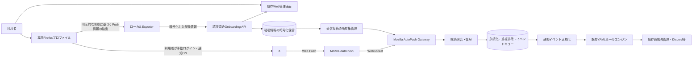

# Angelic Angel 新自動展開システム：Codex実装指示書（Rust → Node.js移植を最初に実施）

- 作成日: 2026-10-13
- 対象: Angelic Angel実サービス／新X（旧Twitter）通知取得基盤
- ステータス: **Phase 0のRust→Node.js機能互換移植を最優先。その完了後に新方式の設計・PoC・実装。技術成立・運用許容性は未確定**
- 対象リポジトリ: **まず作業環境にある実サービスのリポジトリを特定すること**。公開 `sh1ma/Angelic-Angel` は参考Rust CLI／PoCであり、Web管理画面や実サービス本体とは同一と断定しない。

## 0. Codexに最初に与える実行指示（最優先）

**最重要の順序制約: 既存Rust CLIをNode.js/TypeScriptへ完全移植し、機能互換テストに合格するまで、新Push方式の本実装に着手しない。** 既存コード調査とテスト基盤の準備のみ移植前に許可する。必要なテスト用モック、移植設計と比較用フィクスチャの作成はPhase 0の一部としてよい。

あなたはAngelic Angelの設計・実装・テストを担当するシニアエンジニアです。この文書全体を要求仕様および作業指示として読み、以下を厳守してください。

1. **最初にRust実装と実サービスのコードを調査し、Phase 0（Rust→Node.js移植）に着手する。** `README`、リポジトリ内の指示・スキル、設定、依存、テスト、マイグレーション、Web管理画面、API、通知配信、ルールエンジン、既存デプロイ方法を確認する。曖昧な機能を想像で補わない。
2. **Phase 0でRust CLIの全機能をNode.js/TypeScriptへ移植し、Rust版との同値性をテストする。** 移植に際して既存の公開API、CLI、設定読み書き、AutoPushプロトコル、暗号化・復号、Webhook送達を省略しない。移植完了まで旧Rust実装を参照用に保持する。
3. Phase 0受入合格後、新方式の実装前に**少なくとも3案**（サーバー移譲型、ローカルエージェント型、参考の正規配信API型）を比較し、機能・セキュリティ・費用・運用負荷・利用者初期設定・規約面・スケーラビリティ・失効復旧の観点で評価する。第一候補は **Firefox専用プロファイルのWeb Push購読情報を利用者の明示的同意でサーバーへ移譲する構成** とする。比較のために有料API案を挙げてもよいが、有料APIを標準実装に採用してはならない。
4. 推奨案について、**論理構成図・詳細アーキテクチャ図・オンボーディング／受信／障害復旧のシーケンス図・API／DB設計・脅威分析・テスト計画**を先に示し、セルフレビューする。Mermaid等で再現可能な図を残し、経路、認証境界、秘密情報の保存先、失敗時の分岐を省略しない。
5. その後、安全に試せるPoCへ着手する。**技術上のクリティカルな仮説が検証されるまでは本番移行・既存機能の破壊的変更を行わない。** PoC成功を装うモックや、条件を満たさない状態での「完成」報告を禁止する。
6. PoCが成立した範囲から、既存サービスへ段階的に統合する。作業用ブランチを利用し、旧本番設定を勝手に変更せず、本番デプロイ、外部通知送信、実ユーザーの鍵・Cookieを使う試験は事前許可を得る。
7. 可能な範囲で自律的に調査・実装・ユニットテスト・結合テスト・品質検査を行い、最後に差分レビュー、再テスト、残存リスク整理まで実施する。**実行できなかったテストは未実施と明記**し、推測で成功と書かない。
8. 既存の `AGENTS.md`、AIDD／Perfect AIDD Coding関連スキル等が作業環境に存在するなら読み込み、本指示と両立する形で利用する。存在しないスキル名を実行済みと主張しない。
9. 実装上の選択は根拠をADRとして記録する。深刻な技術的／規約上の停止条件が見つかった場合、危険な回避策で先へ進まず、証拠・影響・代替案を提示してその工程を停止する。

**最初に提出する成果物**: Rust↔Node.js機能対照表、TypeScript構成・依存・互換性設計、テストフィクスチャ設計、移植の受入判定。**Phase 0の完了報告後に提出する新方式設計レビュー成果物**: 現行構成の実測調査、要件トレーサビリティ、設計案比較、選定理由、少なくとも構成図1枚・シーケンス図3本、リスク／未検証表、フェーズ別計画、実装対象ファイル一覧。提出後は、安全で独立したPoCまで進める。不要な都度確認で停止せず、権限・認証情報・外部契約・本番変更等の明確な境界のみユーザー確認を取る。

---

## 1. プロダクトの背景と絶対条件

### 1.1 背景

- Angelic Angelの**旧自動展開機能は1年以上提供停止中**。今回の新方式は既存利用者への強制移行ではなく、再提供に向けた新規実装である。
- Xの指定アカウントの新規投稿を取得し、既存の通知先へ転送する機能が中心。現行Web管理画面には通知先／Discord連携・Bot／Webhook管理、条件分岐可能な視覚的ルールビルダーがあり、**ルールのYAMLインポート／エクスポートが可能**である。
- ルールビルダーへ**任意コード実行**または**任意HTTPリクエスト**機能を追加しない。既存ルールと通知先を再利用する。
- **利用者無料**が大きな製品価値。有料X API、投稿数比例の有料プロバイダーをコア取得経路の前提にしない。ただしサーバー・データベース・監視・通信等の運営費がゼロとは限らないので見積もる。
- 検討方式についてのDiscord投票は計26票、賛成19、反対7、その他0。**27%の反対理由は不明**であり、Firefox／PC／スクリプトへの負担を軽視しない。特定の寄付者からChromium系ブラウザーへの対応要望が存在する。
- 新機能完成直後は、**既存寄付者のみを対象に先行提供**し、実利用による安定性・欠落・不具合を検証したのち一般公開を検討する。長期停止へのお詫びも兼ねる。**現在は寄付者も新機能を利用できない**。寄付受付も停止中であり、今回の実装を理由に勝手に再開しない。

### 1.2 絶対に守る制約

- **作業順序は「Rust現行調査 → Node.js/TypeScript全機能移植 → Rustとの互換テスト合格 → 新方式PoC・統合」とする。** Node.js側を今後の本体とし、新方式をRust側に先行実装しない。
- 変換対象の全モジュールと機能を移植対象に含める。旧方式のセキュリティ上の問題は**意図した互換性と安全性改善を分けて記録**し、Xへの外部リクエストは明示的な承認なく実行しない。


- Xのパスワード、ログインCookie（`auth_token`、`ct0`）、セッションを**サービスへ送信・保管しない**。
- 新方式の本番経路でXの非公開APIを叩いてPush登録しない。固定Web Bearer Token、スクレイピング、X Web UIのスクリプト自動操作を自動フォールバックにしない。
- Xに対するフォローやベル設定は**利用者が自分のブラウザーで手動操作する**。利用者のXアカウントをサービス側で自動操作しない。
- 個別ユーザーのPush購読情報をサーバーで収容する。**登録用Xアカウントを大量作成してフォロー上限を回避する構成は採用しない**。
- 初回セットアップにPCとFirefoxが必要となる可能性は仕様上の制約として明記する。セットアップ後はPC常駐なしで通知を受ける方式を目標とするが、実証前に保証しない。
- 普段使いのFirefox／Chromeプロファイルから丸ごとデバイス情報を取得しない。**専用プロファイル**以外をインポート対象にしない。
- ルールビルダーのYAML仕様・実行エンジン・通知先設定の互換性を維持し、不要な全面再構築を禁止する。
- 秘密鍵を持つことによる通知閲覧・なりすまし的受信・配送妨害のリスクを正確に説明し、**「秘密鍵は安全」「リスクゼロ」「Xに絶対検知されない」等の宣伝をしない**。

---

## 2. リポジトリ調査／参考コードの位置付け

公開参考コード: <https://github.com/sh1ma/Angelic-Angel>（確認時点の `main`: 2026-03-05、コミット `169a098e2025cc6e41a50fc8d521c483e21d9b6d`）。以下は**確認済みの公開PoCに関する事実**であり、実サービスの実装状況とは区別する。

| パス | 現状 | 新方式での取り扱い |
|---|---|---|
| `src/twitter.rs` | X非公開API `/i/api/1.1/notifications/settings/login.json` に固定BearerとCookieで登録 | 新方式では呼び出さない。レガシー依存を隔離し、最終的に除去候補とする |
| `src/config.rs` | `auth_token` / `ct0` とPush鍵をTOMLで保持 | Cookie不要の新設定へ分離。鍵の平文保存は禁止 |
| `src/push.rs` | AutoPushへ新規登録し鍵を生成 | **既存のブラウザー購読の移譲**を新しい抽象化として実装。新規AutoPush登録と混同しない |
| `src/autopush.rs` | WebSocket接続、HELLO、ACK、復号用情報処理、再登録処理 | プロトコル参考。UAID変更時に独自登録→X内部APIを呼ぶルートは廃止し、再設定待ちへ遷移 |
| `src/listener.rs` | 復号しWebhook送信してからACK。通知ペイロードをINFOログへ出力 | 受信確定と後段配信を分離。永続化・重複排除・セキュアログ・再送キューが必要 |
| `src/cli.rs`, `src/main.rs` | `init/register/listen/status/unregister` のCLI | 実サービス用Gateway／Importer／保守CLIへ設計変更する場合も既存利用を破壊しない |

**重要**: `sh1ma/Angelic-Angel` は小規模Rust CLI／参考実装で、Discord Web管理画面、ユーザー／寄付者認可、YAMLルールエンジンを含む実サービスコードであることは確認できていない。Codexは作業ディレクトリのGit rootとリモート、ブランチ、技術スタックを最初に記録する。該当コードが見つからなければ、**無関係なrepoへWebアプリを新設しない**。その場合は独立PoCと統合API契約まで進め、統合コードへのアクセスがないことを明示する。

現状のPoCには以下の問題もあるため、そのまま本番化しない。

- `status` コマンドはCookie先頭文字列を表示する。
- デバッグログにX登録要求ボディ、受信通知ヘッダーや復号済み内容を出す経路がある。
- 同じUAIDを複数受信者が使用した場合の衝突を管理する仕組みがない。
- 再接続時にUAIDが変わると旧Push endpointを維持できない可能性があり、旧PoCはX内部APIで再登録を試みる。
- ACKと後段Webhook送信が直結しており、耐障害性と後段の再試行が不十分。

---

## 2A. 移植要件：Rust CLI → Node.js/TypeScript（Phase 0で先に完成させる）

### 2A.1 移植の目的・言語・原則

- **最優先の成果は、既存Rust製Angelic-Angel CLIをNode.jsで動作するTypeScript実装へ、すべての機能と互換性を保って移植すること。** 新Push方式への仕様変更はこの工程に混ぜず、別コミット／別フェーズとする。
- TypeScript（`strict: true`）とNode.jsの**実装時点のActive LTS**を使用する。Nodeランタイム／依存バージョンはロックして再現可能にする。公開CLIはビルド後のJavaScriptで動作させ、エンドユーザーにRustコンパイラーを要求しない。パッケージマネジャーは実サービスの既存方針を優先する。
- 実サービスが既にNode.js／TypeScriptの場合はその規約に従って統合する。Rust CLIとは別物であることを認識し、**実サービス本体をRustからNodeへ全面再構築すると勘違いしない**。
- 新システムのサーバー処理もNode.js／TypeScriptを主軸に設計する。ネイティブRustアドオンやRust CLIへの実行委譲で「移植済み」としてはならない。互換性のための依存ライブラリは使用可だが、導入理由、供給元、メンテナンス状況、セキュリティを検査する。
- Rust版は移植完了まで`legacy-rust/`等へ退避するかGit履歴から同じコミットを再現できるようにし、元のコードを上書き・消去して比較不能にしない。作業リポジトリの構成やユーザー権限に従い配置を決める。

### 2A.2 実装対象の全量マッピング（漏れ禁止）

| Rust | Node.js/TypeScriptでの責務 | 機能互換の確認対象 |
|---|---|---|
| `src/main.rs` | `src/index.ts`、プロセス起動・終了、シグナル制御 | Ctrl+C、終了コード、例外表示、CLIディスパッチ |
| `src/cli.rs` | `src/cli.ts` | `init`、`register`、`listen`、`status`、`unregister`、`-c/--config`、`-v/--verbose`、全引数・ヘルプ |
| `src/config.rs` | `src/config.ts` | TOML入出力、旧設定ファイルを読み込めること、デフォルト設定パス、環境変数、型とバイト配列の互換性 |
| `src/error.rs` | `src/errors.ts` | 独立したエラー種別、原因伝播、診断と終了コード、秘密情報の非表示 |
| `src/push.rs` | `src/push.ts` | P-256鍵対生成、65バイト公開鍵／32バイト秘密鍵、16バイトauth secret、登録結果 |
| `src/autopush.rs` | `src/autopush.ts` | WS/TLS、HELLO/register/unregister/ACK、メッセージ解析、UAID、CHID、ping/pong、close、タイムアウト、再接続、バックオフ、重複排除 |
| `src/listener.rs` | `src/listener.ts` | 通知受信、base64url、`aes128gcm`／legacy `aesgcm` 復号、失敗時ACK、Webhook POST、再接続、信号処理 |
| `src/twitter.rs` | `src/legacy/twitter-registration.ts` | 旧X登録処理のリクエスト形式を**モックで互換検証**。現行方式移植の必要性と新方式での廃止を混同しない |
| `Cargo.toml` / `Cargo.lock` | `package.json`、ロックファイル、`tsconfig.json` | ビルド、CLI起動、テスト、依存の再現性、配布方法 |
| `README.md` / `README.ja.md` | Node版の使用方法、互換性／移行手順 | 起動例、環境変数、旧設定移行の説明、秘密情報に関する注意 |

**レガシー経路の扱い**: Phase 0では既存の`register`や`init`などの外部仕様も移植対象とし、これらを勝手に削除しない。ただし実Xへの旧非公開API送信は危険な操作のため、テスト時は完全モックとする。旧登録処理は明確に`legacy`として隔離し、実環境での実行は**明示許可がある場合だけ**可能な設計とする。Phase 1以降の新方式に旧登録を混ぜない。互換性と安全性が衝突する変更は、根拠・影響・移行策・互換性テストの期待差分を記録し、安易に「完全互換」と宣言しない。

### 2A.3 Node移植の互換性要件（MIG）

- **MIG-001 CLI**: Rust版のサブコマンド、オプション、既定値、ヘルプ、正常／異常終了コード、Ctrl+C挙動をNode版で実装する。人間向け表示の差異は文書化し、機械が解釈する出力は可能な限り維持する。
- **MIG-002 設定**: 既存`angelic-angel.toml`をNode版で読み込み、必須／任意フィールド、byte array、URI、configパス、`WEBHOOK_ENDPOINT`を正しく扱う。旧設定の読み替えやマイグレーションを提供する場合は、破壊せずバックアップと可逆性を確保する。
- **MIG-003 AutoPush**: 接続、HELLO、REGISTER、UNREGISTER、ACK、`use_webpush`、`channelIDs`省略、UAID一致検証、メッセージ構造、未知応答、異常Closeを完全に網羅する。
- **MIG-004 暗号**: P-256 ECDH秘密鍵とSEC1非圧縮公開鍵、Web Push用HKDF/ECE、`aes128gcm`とlegacy `aesgcm`の復号を実装し、**Rust版と同一の暗号フィクスチャ**で正解平文を検証する。Node組み込み暗号／監査可能な既存ライブラリを優先し、自作暗号の安易な導入を避ける。
- **MIG-005 接続維持**: WebSocketメッセージのping/pong、アイドルタイムアウト、TCP keepalive、コネクション確立／切断、バックオフ上限、close code `4774`等をRust実装と照合する。旧挙動の不具合がある場合は変更理由を明示する。
- **MIG-006 配信**: `WEBHOOK_ENDPOINT`宛てのJSON POST、HTTP成功／非成功、ネットワーク失敗、タイムアウト、ログ、リトライ条件を明確にし、正常系と異常系をテストする。
- **MIG-007 登録状態**: AutoPushの`uaid`・`channel_id`・`endpoint`・鍵を設定へ保存し再起動後に使用できる。生成前状態・失効・異常データの扱いを揃える。
- **MIG-008 セキュリティ**: Node版は既定で秘密値をログ・CLI・テスト結果へ露出しない。Rust版のCookie先頭表示／生Push本文INFOログ／登録リクエスト詳細ログを無批判に再現しない。差分として明示する。
- **MIG-009 依存と配布**: `build`、`start`、`lint`、`typecheck`、`test`のスクリプトを用意し、README記載の手順でクリーンな環境から再現できる。ソースマップ、実行ファイル入口、Windows/macOS/Linux依存を確認する。
- **MIG-010 テスト戦略**: 同一フィクスチャをRust・Nodeの両方で実行し、正規化した観測結果で比較する。Rust版が外部に依存する部分は制御可能なモックサーバーへ差し替える。
- **MIG-011 回帰**: オプション・設定・エラーハンドリング・crypto・WSプロトコル・Webhookが機能ごとに機械的テストで保護されていることを確認する。
- **MIG-012 変更分離**: Phase 0では新Firefox購読移譲やサーバー分散処理を本実装しない。将来必要な抽象境界の準備はよいが、新旧の仕様を混在させない。
- **MIG-013 追跡可能性**: `Rust関数/型/CLI → Node実装箇所 → テストID → 成否`のトレーサビリティ表を更新する。未移植項目を黙って除外しない。
- **MIG-014 完了判定**: `MIG-001〜013`を満たし、ビルド・lint・typecheck・unit・protocol integration・暗号相互運用テストを実行して成功すること。実X接続を伴うE2Eは権限・外部制約があるなら「未実施」と区別する。

### 2A.4 最優先のテストと落とし穴

1. **Golden master**: RustのCLI `--help`、`status`、不正設定、入力エラーを固定テストし、Node版と比較する。秘密値は必ずダミーにする。
2. **TOML相互運用**: Rustで生成したダミー`angelic-angel.toml`をNodeで読み、Nodeで書き出したファイルをRust側で読み取れること。順序／整形差は許容し、意味値で比較する。
3. **E2E暗号互換**: P-256秘密鍵の32バイト固定長・公開鍵65バイト、鍵導出、`aes128gcm`・`aesgcm`・誤鍵・改ざんを検証。固定テストベクターは秘密ではないダミー値のみ。
4. **模擬AutoPush**: HELLO一致／不一致、通知の途中到着、ACKコード100/101/102、再接続、ping/pong、重複通知、code 4774を再現するローカルWSモックを作成する。
5. **Webhookモック**: 2xx、4xx、5xx、切断、タイムアウト、重複受信を再現。既存Rustで非2xxを成功扱いする経路は不具合として比較・修正理由を記録する。
6. **エラー注入**: 接続が途中で切れる、保存領域がreadonly、設定破損、秘密情報がログに入る、SIGINTで中断などを確認する。
7. **静的セキュリティ**: X Cookieを使う旧コードの隔離と新コードでの秘匿を確認。登録要求モック以外で旧内部APIへ接続しないことをテストする。
8. **プラットフォーム**: WindowsでPowerShellからNode CLIを起動可能であることと、Mac/Linuxの起動可否を検証。未実機確認のOSは未検証とする。

**Phase 0の受入ゲート G0**: 全モジュール移植、機能対照表に未移植ゼロ、互換テスト合格、運用上危険なレガシー通信は既定無効、クリーンインストールと起動の再現ができること。満たせない場合は**新方式実装へ進まず**、必要な依存・追加の環境・未達原因を報告する。外部認証が必要で実機E2Eを実行できない場合は、その点を例外として未検証と記し、モックで検証した範囲を明確にする。

---

## 3. 設計案の比較（実装前にCodexが最新調査し直す）

| 案 | 取得モデル | 利用者PC常駐 | ユーザー初期設定 | サーバーで扱う秘密情報 | 主なボトルネック |
|---|---|---|---|---|---|
| **A: Firefox購読のサーバー移譲**（第一候補） | 手動X通知購読→Mozilla AutoPushをサーバーで受信 | 目標: 不要 | 初回PC＋Firefox＋明示的移譲 | UAID、CHID、Push秘密鍵・auth secret等 | 実際の購読移譲、UAID寿命、Mozilla非標準接続、UX |
| B: ローカル受信エージェント | 利用者PC上でPush受信→既存サービスへイベント転送 | 必要 | PC＋アプリ | ローカルで秘密鍵保管 | PC依存・端末停止時の欠落 |
| C: 正規X API／契約データ提供 | 公認API・配信 | 不要 | 原則不要 | 管理者APIキー等 | 投稿数比例の費用・契約。**無料コア要件を満たさない** |

- Aは「技術的に必ず可能」ではなく、仮説。PoCのゲート条件を通過した場合に本命として採用する。
- BはAが技術的／運用的に不成立の場合の評価候補。無断で本実装をBへ切り替えない。
- Cは比較対象であり、自動課金する実装をしない。
- **Chromium/Chrome/Brave/Opera対応は別アダプターの後続課題**。FirefoxのUAID形式やDBをChromeに適用できると仮定しない。ChromeではFCM／GCM機器識別・保存形式・接続先が異なる可能性があるため別PoCを要求する。

### 3.1 第一候補の論理構成



**注**: この図は狙う機能境界であり、実際の構成・サービス名・保存技術は現行実装の調査後に決める。図に書いた矢印について、必要な認証／認可／秘密データを詳細設計で明示する。

### 3.2 分離すべき責務

- **Client Setup / Exporter**: 専用Firefoxの準備、正規購読状態確認、X用購読のみの抽出、利用者への明示的説明、受渡し。ネットワーク通信なしで抽出・検査できるモードを用意。
- **Onboarding API**: Angelic Angelログイン済みユーザーと1回限りの登録セッションの紐付け、CSRF／リプレイ防止、登録情報の検証、保管、状態遷移。
- **Subscription Registry**: 所有者、ブラウザー種別、UAID／CHID、endpoint、鍵、世代、接続状態、失効、同意、削除要求を管理。
- **AutoPush Gateway**: 複数接続の確保、HELLO、受信、ACK、指数バックオフ、サーバー指示の待機、状態記録、終了。Xへの直接通信はしない。
- **Event Processor**: 復号、schema検証、投稿イベント識別、永続化、重複排除、配信キュー、既存ルールエンジンに渡す。
- **Delivery**: 既存通知ルーティング、通知先への再試行、成功／失敗状態。外部任意リクエストブロックは作らない。
- **Operations**: 機能フラグ、寄付者先行制限、監視、アラート、データ削除、ロールバック。

---

## 4. 機能要件（IDで追跡する）

### 4.1 初期セットアップ・同意

- **FR-001**: ユーザーは既存Web管理画面からX通知ソースの追加を開始できる。既存認証を再利用し、未ログイン者は登録できない。
- **FR-002**: Firefox専用プロファイルを利用する。普段使いのプロファイルの流用を既定では禁止し、専用プロファイルか判断できない場合は失敗にする。
- **FR-003**: 利用者自身が専用FirefoxでXへログインし、対象アカウントの投稿通知とブラウザー通知を手動で有効化する。セットアップツールがCookie、Xパスワード等を取得しない。
- **FR-004**: ExporterはX由来の購読情報を選別し、`UAID`、`CHID`、`Push endpoint`、`p256dh public/private key`、`authenticationSecret`、必要な追加メタデータを形式付きで出力する。**実際に何が必要かはFirefox実装を調査して確定**し、取れない情報を捏造しない。
- **FR-005**: 設定時に「取得内容」「サービスが復号可能な通知範囲」「サーバーでの保管・削除」「再登録が必要になる可能性」を説明し、明示的な同意を取る。未同意の場合は送信しない。
- **FR-006**: `-WhatIf`相当の参照・確認モード、送信前プレビュー、秘密値マスキング、読み取り対象の明示、スクリプトの監査可能性を提供する。PowerShellと必要最小限の公開テキスト補助コードを基本とし、管理者権限を要求しない。配布用GUIは後続でもよいが設計に含める。
- **FR-007**: Exporterの抽出・検査処理は原則オフラインで動作し、外部通信が必要な登録フェーズと分離する。抽出結果はディスクへ不用意に平文で永続化しない。一時ファイル使用時は保護・明示・削除を行う。
- **FR-008（2026-10-14最新指示で置換）**: X以外のPush購読も存在する場合、§16の説明と保存直前の明示確認を行ってXだけのファイルを作成できる。共有UAIDによる他サイト通知のサーバー到着・技術的な取得可能性・別途許可までの破棄と配送への影響を説明する。他サイトの鍵を出力せず、未知CHIDを復号・永続保存・利用しない。
- **FR-009**: ブラウザーからサーバーへ登録情報を移し、登録成功・鍵検証・試験通知の結果とともに接続状態を表示できる。
- **FR-010**: セットアップを途中で止めても既存通知設定やアカウントに副作用がない。誤選択したプロファイルへの無断アクセスを行わない。

### 4.2 サーバー側受信

- **FR-011**: 利用者別にインポートされたPush購読情報を管理し、同じUAIDを複数Workerが同時に保持しないようLease（期限／fencing token含む）で制御する。
- **FR-012**: AutoPush接続・HELLO・受信・復号・ACKを処理する。接続復旧時はバックオフ／ジッタ／サービスからの再接続制限を尊重する。
- **FR-013**: `UAID`変更・購読失効を検出したら、X内部APIで自動再登録せず**`REQUIRES_USER_REENROLLMENT`**に遷移し、所有者へ案内する。旧購読を新しいUAIDへ無断付け替えしない。
- **FR-014**: 復号済みの通知を既存ルールエンジンの入力形式へ正規化し、既存通知先へ渡す。ルールのYAML import/exportとの互換性を維持する。
- **FR-015**: 投稿ID・作者IDを通知本文から確実に得られる場合だけ構造化する。Xが返す通知は「全投稿の完全なイベントストリーム」とは限らないため、通知種別（投稿／返信／リポスト等）を無根拠に判定しない。
- **FR-016**: 保存成功後にACKする構成を優先し、後段のDiscord/Webhook障害がAutoPushセッションを占有しないようにする。ACK済み・キュー永続化済み・送達済みを別々の状態として管理する。ACKの意味は実プロトコル仕様に整合させる。
- **FR-017**: 重複排除はメモリー上の「最新100件」だけに依存しない。少なくとも購読ID＋通知version、取得できる場合は投稿IDを持続的な一意キーにする。再起動後にも重複爆発しない。
- **FR-018**: 通知を受け取ったユーザー以外へ誤配送しない。購読→所有者→ルール→通知先の紐付けを認可・参照整合性で保証する。
- **FR-019**: インポート済み購読情報を無効化／再登録／削除できる。サービス上の登録削除と、Firefox／X側の実購読解除可能性を区別して説明する。旧端末や旧Push endpointの無効化を保証しない。
- **FR-020**: Gatewayのプロセス終了、ネットワーク切断、サーバー再起動、Worker移動から、永続データを失わず復帰する。

### 4.3 管理画面・権限・提供方式

- **FR-021**: 既存Web UIの通知ソース追加画面・通知先・視覚的ルールビルダーへ自然に統合する。新システムのために別の管理画面全体を作り直さない。
- **FR-022**: 先行提供では既存寄付者の認可状態を既存サービスの正規DB／権限モデルから判定する。**寄付者とみなす条件を推測してDBを改変しない**。権限不明時は利用不可とする。
- **FR-023**: 一般公開は運営者の機能フラグで制御し、初期状態は非公開。現在は寄付者に対しても利用可能だと誤表示しない。
- **FR-024**: 初回登録時、接続中、受信待機、最終受信、同期不能、再登録必要、サービス側停止、削除済みを明確に表示する。
- **FR-025**: 再登録案内、エラーコード、簡易FAQ、問い合わせに必要な相関IDを提供する。秘密値や通知本文をサポート窓口で収集しない。
- **FR-026**: ユーザーが設定した監視対象のフォロー／ベル設定はX側で管理されるため、サービスが勝手に「どのアカウントを通知ONにしているか完全把握できる」と表示しない。
- **FR-027**: 通知ルールのYAML import/exportは既存仕様を尊重し、バージョン差がある場合には既存ルールを自動変換できるかを検証する。実行可能範囲は定義済み安全ブロックのみとする。
- **FR-028**: ブラウザー別アダプターのinterfaceを用意するが、最初の受入対象はFirefox。Chrome/Brave/Operaの実装・対応予定日を保証しない。

### 4.4 運用・観測

- **FR-029**: 受信／復号／キュー投入／ルール適用／通知先送達の成否を別々に測定する。
- **FR-030**: ブラウザーまたはPushサービスによる再登録が必要な事象を追跡し、ユーザー通知と運用アラートにつなぐ。
- **FR-031**: 寄付者向けβ期間のフィードバック／バグ報告を整理できるよう、匿名化したバージョン・エラーコード・相関IDを採番する。
- **FR-032**: 個人・機密情報を含むログは既定で保存しない。アカウントIDやUAIDなどは必要に応じてハッシュ化／最小表示する。

---

## 5. セキュリティ・プライバシー・規約上の要件

### 5.1 保護対象と禁止動作

保護対象は、UAID／CHID／Push endpoint、`p256dh`秘密鍵、`auth secret`、通知本文、ユーザーと通知先の対応関係、および既存サービス認証情報。Push endpointもCapability URLとして機微性がある。

- **SEC-001**: サービスへの送信は認証済みHTTPS＋一回限りの登録セッションで行う。セッションは短時間有効、所有者にバインド、ワンタイム、リプレイ不可。
- **SEC-002**: 秘密鍵・auth secret・Push endpoint等を暗号化して保管し、復号権限を受信Workerに限定する。キー管理・ローテーション・復号監査を設計する。
- **SEC-003**: APIではCookie／`auth_token`／`ct0`／ブラウザー保存パスワード・履歴・プロファイル丸ごとのアップロードを拒否する。余分なフィールドを無視せず入力バリデーションで排除する。
- **SEC-004**: レスポンス、アクセスログ、例外、トレース、メトリクス、デバッグで機密値・X通知本文・秘密鍵を出さない。既存PoCの危険なログ経路をそのまま移植しない。
- **SEC-005**: 利用者が自分の登録情報だけを閲覧・更新・削除できる認可テストを実施する。IDOR、別ユーザー宛て誤配送、二重インポートを防止する。
- **SEC-006**: 不正なUAID、CHID、鍵長、endpoint、`scope`、serverKey、ブラウザ種別、暗号方式を弾く。未知のチャンネルが届いた場合の扱いはFail-closedとし、データを保存・表示しない。
- **SEC-007**: インポートツールは署名やハッシュ照合など改ざん検証策を設ける。GUI配布時も参照できるソースコードと実際の配布物の一致方法を示す。
- **SEC-008**: 実ユーザー秘密情報をテストfixture・Git履歴・Issue・CIログ・サンプルJSONに入れない。
- **SEC-009**: データ削除・退会・同意撤回時の削除期限、暗号化鍵廃棄、バックアップからの保持期間、通知配信停止タイミングを明記する。
- **SEC-010**: 外部送信先のWebhookは既存通知先管理によってのみ決定する。X通知を使って任意HTTPリクエストや任意コード実行を行う機能は実装しない。
- **SEC-011**: 大規模・第三者のAutoPush接続によるMozillaへの負荷やサポート可否を事前評価する。接続上限を回避する分散・偽装や要求頻度制限の回避を行わない。
- **SEC-012**: Xの自動化規則、Mozilla AutoPushの利用条件、個人情報の扱いに照らした運用レビューを行い、許容性を確認できない場合は本番移行を保留する。

### 5.2 利用者が理解できる説明文の要点

- 「Xへのログイン用パスワードやCookieは送信しません」。
- 「専用Firefoxのブラウザー通知を**サーバーが受信・復号できる情報**を登録します」。
- 「X以外の通知を巻き込まないため、普段使いのプロファイルは使用しません」。
- 「登録時のみPCが必要です。以後のPC常駐不要は検証対象で、再設定が必要になる場合があります」。
- 「通知はXからのPush配送に依存し、全投稿を100%検知できるとは限りません」。
- 「不要になればサービス上の登録情報を削除できます。ただしX／Firefox側の購読解除は別操作になる場合があります」。

---

## 6. 推奨データモデル・API（現行スタックに合わせ調整可）

※エンティティ名／型は設計の出発点。既存DB・既存ユーザーID・既存通知先のモデルを優先し、二重マスタを作らない。

### 6.1 エンティティ

1. `push_onboarding_sessions`: `id`, `owner_user_id`, `nonce_hash`, `expires_at`, `consumed_at`, `created_at`, `consent_version`, `status`。
2. `push_subscriptions`: `id`, `owner_user_id`, `browser=firefox`, `profile_label`, `scope`, `endpoint_enc`, `uaid_enc`, `chid_enc`, `public_key`, `private_key_enc`, `auth_secret_enc`, `app_server_key`, `generation`, `state`, `created_at`, `last_hello_at`, `last_notification_at`, `last_error_code`, `deleted_at`, `consent_version`。
3. `push_connection_leases`: `subscription_id`または`uaid_fingerprint`, `worker_id`, `fencing_token`, `lease_until`, `updated_at`。一意性を保証する。
4. `push_inbox`: `id`, `subscription_id`, `channel_id_fingerprint`, `push_version`, `payload_ciphertext_or_normalized`, `received_at`, `processing_state`, `failure_code`, `processed_at`, `dedupe_key`。
5. `notification_delivery_jobs`: 既存配信キューがある場合は拡張し、`event_id`, `destination_id`, `attempt`, `next_attempt_at`, `status`, `last_error`などを持つ。
6. `feature_access`: 既存権限の参照／feature flagを再利用し、寄付者フラグの新マスタは原則作らない。

すべての機微情報を複合キーやユニークインデックスに平文で配置しない。必要な照合には適切なHMAC fingerprint等を利用する。状態は、少なくとも `PENDING`, `READY`, `CONNECTED`, `DISCONNECTED`, `REQUIRES_USER_REENROLLMENT`, `DISABLED`, `DELETED` を表現する。

### 6.2 API候補（既存命名規則優先）

| 機能 | 操作例 | 必須の保護 |
|---|---|---|
| オンボーディング開始 | `POST /api/push/onboarding-sessions` | 認証・寄付者feature gate・レート制限・CSRF対策 |
| 移譲データ登録 | `POST /api/push/subscriptions/import` | 認証・短期nonce・所有者紐付け・検証・秘密情報秘匿 |
| 状態確認 | `GET /api/push/subscriptions` | 所有者スコープ・機密情報非表示 |
| 再登録開始 | `POST /api/push/subscriptions/{id}/reenroll` | 所有者認可・世代管理 |
| 無効化／削除 | `DELETE /api/push/subscriptions/{id}` | 所有者認可・配信停止・削除反映 |
| ヘルス確認 | 内部管理用 | 管理権限・顧客情報の露出禁止 |

レスポンスへ秘密鍵・auth secret・完全なUAID・Push endpointを返さない。ブラウザーからのインポートはCSRFだけでなく、登録セッションとAngelic Angelログインユーザーの確実な紐付けが必要。

---

## 7. PoCで立証すべき重要仮説（不成立なら本実装を停止）

| ID | 仮説 | 検証方法 | 合格条件 |
|---|---|---|---|
| **POC-01** | 現行FirefoxでXの正規Web Push購読が成立する | **専用テストプロファイル・テストXアカウント**で手動購読し状態確認 | Xからの通知がFirefox側で実際に届く。使用バージョンと手順を記録 |
| **POC-02** | Web Push移譲に必要な情報を安全に取得できる | Firefox現行ソースと実プロファイルを調査。`PushRecord`の保存場所・暗号鍵表現を確認 | X用scope／UAID／CHID／復号鍵／auth secret等を取得でき、Cookie・他プロファイル情報に触れない。方法が監査可能 |
| **POC-03** | 既存UAIDでサーバーがAutoPushを継承できる | Firefox終了後、独立クライアントからHELLO→Notification | 同じ購読宛て通知を受信。独自に新登録した別CHIDでは代用不可 |
| **POC-04** | 既存鍵で通知本文を復号できる | 既知のテスト通知を送受信し、Firefox受信結果と比較 | 実受信データが復号・識別できる。外部ネットワークなしの暗号テストも通過 |
| **POC-05** | Firefoxとの同時使用による競合を制御できる | 専用プロファイル停止→サーバー起動、競合を試験環境で再現 | 衝突の検出・説明・安全な停止ができ、普段使いプロファイルに影響しない |
| **POC-06** | 切断、プロセス再起動後に復旧できる | 再接続、timeout、背後のAutoPush停止のモック、実再接続 | データ重複・損失を記録し、規定バックオフで復旧／停止できる |
| **POC-07** | UAID変更を検知し安全に止まれる | HELLOに別UAIDが返るモック／試験 | 自動X非公開API登録を行わず、再登録要求へ移行 |
| **POC-08** | X通知から必要なソース情報が得られる | 実際の通知を匿名化してパターン収集 | 投稿ID・author・本文等の有無を一覧化し、取れないものは機能保証しない |
| **POC-09** | 非Firefoxクライアント接続の運用が許容可能 | Mozillaの現行設計・規定、必要に応じて公式窓口を確認 | 大規模運用を前提とした明確な停止要因がないことを確認。未確認なら一般公開しない |

**禁止**: モックのAutoPushを使った単体テスト合格だけでPOC-03/04が実証できたと報告すること。Xの通知1件成功のみで全投稿を欠落なく配送できると断定すること。

### 7.1 ライブ試験の最小シナリオ

- 使用するFirefox版、OS、テストXアカウント、プロファイル識別、通知設定の手順をログへ記録する（Cookieや鍵は記録しない）。
- 正常通知を数件受信し、暗号解読・通知ソース解析・既存サービスへの模擬ルーティングができること。
- 同一通知を再送した場合に1回だけ処理されること。
- サーバー停止→再起動で同一購読へ戻れること。
- X以外のPush購読もある場合、保存前の説明と明示確認、拒否・取消時の未出力、Xだけの出力、サーバー側の非利用・破棄とX受信継続を確認すること。
- UAID変更と保管鍵破損時に、X APIへ再登録しないこと。
- 通信障害、Web Push欠落、X側未通知のケースを区別して診断できること。

---

## 8. 品質・非機能要件

- **NFR-001 可用性**: 接続死活監視、再接続バックオフ、保存キュー、Worker異常再起動、障害復旧手順、切り戻しを備える。
- **NFR-002 一貫性**: サーバーは「Push受信は少なくとも一度・下流は冪等」を基本とし、実際のAutoPush意味論に合わせる。重複は受信時と配信先の両段階で抑制する。
- **NFR-003 遅延**: Gateway受信→キュー登録、キュー→通知先の各遅延分布を測定。外部Xから通知自体が出る遅延と区別する。数値SLOはβ実測から決める。
- **NFR-004 容量**: `1 / 100 / 1,000 / 10,000`等の規模を段階的に評価する。ただし公共Mozilla AutoPushへ無許可で大量負荷を掛けない。負荷試験はプロトコル模擬サーバーで行い、実サービスの接続数増加は運用許容性確認後に限定する。
- **NFR-005 観測**: アカウント数・状態別購読数・WebSocket健全率・再接続回数・UAID変化・復号失敗・未知CHID・キュー滞留・通知成功率・ユーザー再登録率・外部依存障害をメトリクス化。
- **NFR-006 セキュアログ**: Raw payload、UAID、endpoint、秘密鍵、通知本文、X Cookie等はログに出さない。例外スタックにも含まれないことをテストする。
- **NFR-007 冪等性**: 同じインポートを繰り返しても購読・配信が二重化しない。同じUAIDが別アカウントから登録された場合は安全に拒否／調査待ちにする。
- **NFR-008 プライバシー**: 同意撤回・削除、保持期間、暗号鍵ローテーション、権限ごとの開示範囲をドキュメント化。
- **NFR-009 運用費**: 利用者1人あたりのメモリ・ソケット・CPU・DB・帯域・暗号化コストを測定し、ユーザー無料モデルの持続可能性を試算。
- **NFR-010 規約**: XやMozillaの制約に関して想像で「問題なし」と書かない。本番開始前の明示的レビュー・承認事項とする。

---

## 9. 詳細テストマトリクス

### 9.1 ユニット／プロパティテスト

- ベース64・UUID・暗号鍵長の不正入力、切り詰め・改ざん・未知エンコーディング。
- 正規・不正AutoPushメッセージ、HELLO失敗、異常close、サーバーバックオフ。
- 重複Push version／同一投稿ID／順序逆転／同時受信。
- ACK送出前クラッシュ、キュー永続化後クラッシュ、送達後ACK失敗、配信キュー再試行。
- 期限切れ登録セッション、2回目のnonce利用、別アカウントでの登録。
- 他サイトscope、他プロファイル、複数X関連scope、複数CHID等の判定。
- Secretを含む例外・Debug表示・Serialize・ログがRedactされること。
- YAMLルールの読み込み／書き出し往復テスト。既存ルール実行の回帰試験。

### 9.2 結合／E2E

- Web認証→寄付者feature gate→オンボーディング→秘密鍵保存→Gateway受信→正規化→既存ルール→既存Discord通知先まで。
- 一般ユーザーの機能拒否、寄付者の先行利用許可、フラグOFF時の完全閉塞。
- AユーザーがBユーザーのPush状態・通知先・イベントを読めない／配信できない。
- 新規登録、再登録、削除、同時接続拒否、Worker引継ぎ、再起動、レート制限。
- 既存通知先と既存YAMLルールの全面回帰。任意HTTP要求機能が追加されていないこと。
- 疑似エンドポイントだけではなく、明示許諾された少数の実X通知による動作検証（認証情報はログ保管しない）。

### 9.3 確認コマンド（実スタック確認後に適用）

Node.js／TypeScript実装では、`npm ci`（または採用済みパッケージマネジャーの再現可能インストール）、`build`、`lint`、`typecheck`、`test`、暗号相互運用・プロトコル結合試験、依存検査を行う。Phase 0のRust比較用に`cargo fmt --check`、`cargo clippy --all-targets -- -D warnings`、`cargo test`も実行可能な範囲で実施する。以後の新方式の実装・サーバー処理は原則Node.js/TypeScriptで行う。Webフロント／バックエンドは実サービスの標準CIも実行する。**実行環境がない場合は代替で実行できた範囲と未実施範囲を分けて報告**する。

---

## 10. フェーズ別の実装順序と停止ゲート

**Phase 0が最優先であり、G0合格前にPhase 1以降の新方式の本実装へ進まない。** 設計上の課題は調査・記録できるが、Node移植を後回しにしない。

### Phase 0 — Rust → Node.js/TypeScript全機能互換移植（必須・最優先）

1. 作業環境のGit rootと旧Rust CLI全ファイルを特定し、現在のCLI・暗号・接続・再接続・Webhook・設定の動作をコードで確認する。実サービス本体との関係も明らかにする。
2. `2A`のファイルマッピング・MIG-001〜014について、テスト仕様とNode版の実装場所を決定する。Rustの動作を固定できるものは先にフィクスチャにする。
3. Node.js Active LTS＋TypeScript strictのプロジェクトを構成し、モジュール単位でRust実装を完全移植する。旧コードを参照可能なまま残し、既存サービスと同じpackage managerの規約に従う。
4. 現行CLI全サブコマンド、TOML/ENV、WebSocket/AutoPush、ECE復号（両方式）、鍵生成、Webhook、SIGINT/異常系を実装する。危険な旧X登録要求は隔離し、モック比較と実環境実行の明示許可を分離する。
5. モックサーバー・既存ダミー設定・暗号フィクスチャによるRust↔Nodeの機能同値テストを行い、差分を列挙・修正する。
6. ビルド、型検査、lint、unit、protocol integration、暗号互換、エラー注入、クリーンインストールを実行し、テスト結果と未実施範囲を記録する。
7. Node版への移行手順と互換性の証拠をまとめ、機能対照表を未移植ゼロにする。以後の変更対象はNode/TypeScript実装とする。

**成果物**: Node.js/TypeScriptの全ソース、ロックファイル、テスト一式、Rust↔Node機能互換表、再現手順、移行README、Phase 0レビュー記録。

**ゲートG0**: 2A.4の基準を満たさない限り、Phase 1以降の新Push方式の本実装へ進まない。

### Phase 1 — 現行調査・新方式設計・危険領域の明確化

1. すべての関連Git root、依存、既存ユーザー・寄付者・通知先・YAMLエンジンの処理を調査。
2. 3案比較表、構成図／シーケンス図、セキュリティ境界、API、DB、リソース試算、PoC計画を作成。
3. 現行コードの変更対象と維持すべき後方互換を一覧化。
4. 仕様上の矛盾・未確認事項を「阻害度／確認方法／責任者」付きで列挙。
5. セルフレビューを行い、図の流れ・抜け・不明点を修正する。

**成果物**: `docs/architecture/...`, `docs/adr/...`, `docs/requirements-traceability.md` 等（既存規約に合わせた配置）。

### Phase 2 — 独立PoC（クリティカルパス）

1. Firefox現行版のPushストレージ、UAID、CHID、crypto stateの確認と安全な抽出手段の立証。
2. 独立AutoPush receiverに既存購読情報を注入し、実通知を受信・復号。
3. 再接続、UAID無効、秘密鍵不整合、ACK、同時接続をテスト。
4. PoC結果を再現手順・ログ（機密削除）・実測で報告。

**ゲートG1（技術PoC）**: `POC-01〜08` のクリティカル部分が実証できない場合、**本番統合に進まず**原因と代替案を提出。規約上の外部サービス利用可否 `POC-09` も一般提供前に必須。

### Phase 3 — サーバー統合基盤

1. 秘密情報のモデルと暗号化、ユーザー紐付け、オンボーディングAPI。
2. 接続所有権・多重化・Gateway・重複排除・永続Inbox・ACK。
3. イベント正規化、既存ルールエンジン／通知先へのアダプター。
4. オブザーバビリティ、失効再登録、削除、feature flag。

**ゲートG2**: 負荷・漏洩・誤配送・回帰テストが合格するまでは運用トラフィックへ投入しない。

### Phase 4 — ユーザーセットアップ

1. PowerShell／公開テキスト実装で読み取り・検査・送信を分離し、ユーザーが内容を確認できること。
2. Firefox専用プロファイル作成案内、誤プロファイル判定、安全なアップロードと消去。
3. Web管理画面の操作導線と状態表示、再登録通知、プライバシー説明。
4. 一般ユーザーにPowerShell必須を恒久化するか、監査可能なGUI化まで進めるか、β評価で決定。**GUIで内部リスクが消えるとは主張しない**。

**ゲートG3**: ユーザーテストで手順を完遂でき、誤認や秘密情報取り扱いの問題がないこと。

### Phase 5 — 寄付者先行β

1. 限定フラグをON（明示許可後）、既存寄付者のみ登録可能。
2. 通知欠落・遅延・失効・再登録頻度・運用費を計測。
3. バグ報告導線とログ相関IDを整備。利用者へ「暫定」「再設定可能性」を表示。
4. 30〜90日の継続観測計画を作成。期間経過前に安定性を断言しない。

**ゲートG4**: 測定結果、安全性、Mozilla運用許容性、利用者サポート体制が確認されるまで一般開放しない。寄付受付の再開は**別判断**。

### Phase 6 — Chromium検証（別スコープ）

- ChromeのX Web Push購読とFCM／GCM実装を現行Chromiumソースと実機で調べる。
- ブラウザープロファイル全体の機密性がより強く関わる場合、Chrome/Brave/Opera対応を安易に約束しない。
- Firefox用アダプターのinterfaceを流用できる範囲のみ共通化し、**Chromeの識別子をFirefox UAIDの代替として扱わない**。
- 本番公開前には別途安全性・規約・実機PoC・セットアップUXを満たす。

---

## 11. Codexのセルフレビュー／受入条件

変更実装ごとに以下を機械的・手動で検証し、結果をレビュー記録へ残す。**最初のG0判定では、Rust→Node機能対照表、設定互換、CLI挙動、暗号・プロトコルのGolden master、モックE2Eを必ず確認する。**

**設計レビュー**
- 構成図にクライアント、X、Mozilla、Gateway、DB、キュー、ルールエンジン、通知先が全てある。
- 全矢印に方向、認証・暗号化の境界、データ種別が定義されている。
- 接続所有権／複数Worker／UAID変更／再登録／削除の例外経路がある。
- 既存ルールエンジンと通知先を再利用し、ダミーの別サービスを作っていない。
- 不確実な技術事項を「実証済み」と誤記していない。

**コードレビュー**
- データフローを逆追跡し、Cookie、パスワード、Push秘密鍵、通知本文の漏洩経路がない。
- `User-Agent`の偽装や接続間隔の細工で検知や制限を回避する実装を追加していない。
- ユーザー所有の秘密情報・通知先を他ユーザーが読めない。
- エラー処理、リトライ、タイムアウト、冪等性、状態整合性が網羅されている。
- 全改修ファイルのlint・typecheck・テスト・依存検査を行う。
- ログ、設定、Git差分、サンプルに秘密値や実ユーザーデータがない。

**受入の最低条件**
0. **Rust→Node.js/TypeScriptへ完全移植済みで、G0合格済み**。Rustの全機能がNodeで実行でき、後続はNodeをベースにする。
1. Firefox専用プロファイルでの正規購読から**実通知のサーバー受信と復号**まで再現可能である。
2. 復号通知が既存サービスのユーザー／通知ルール／通知先と正しく紐付く。
3. X Cookieを取得しない・非公開X APIを呼ばないことを静的検査と通信記録で確認できる。
4. 突発切断・再起動・失効・重複・誤った鍵・異なるユーザー登録で安全に動作する。
5. 寄付者先行フラグOFF時は誰も登録できず、利用中の誤解を招く表示がない。
6. 運営費、Mozillaへの接続数／負荷、利用条件について、本番化の判断材料が揃う。
7. 上記が満たせないなら、未達要件と停止点を明示してPoC段階で止める。

---

## 12. Codexが最終的に提出するもの

0. **Phase 0 移植成果**: 全Node/TypeScriptソース、Rust↔Node機能対照表、互換テスト、README、旧実装との差分・失敗時の安全策。
1. **現行調査報告**: 実サービスの関連ファイル一覧・構造・依存・旧方式との関係。
2. **設計案比較**: A/B/C、採用理由、リスク、概算工数と運用原価。
3. **詳細設計**: 構成図、シーケンス図、DB、API、状態遷移、秘密情報フロー、脅威モデル。
4. **PoC結果**: 動作したことと失敗したこと、条件、実際の出力、実測、再現手順。
5. **実装**: 変更したソース一式、マイグレーション、設定サンプル、feature flag、セットアップツール、手順書。
6. **テスト**: 実行コマンド、成功件数、失敗件数、未実施理由、パフォーマンス・障害試験結果。
7. **セルフレビュー結果**: 指摘一覧、修正、再テスト、既知課題・β段階の制約。
8. **運用ガイド**: 接続障害、UAID変化、鍵削除、登録解除、β→一般開放、ロールバック、費用観測。
9. **未解決事項**: 明示的なユーザー承認が必要な判断（サービス規約・本番・データ保持期間・外部接続負荷・寄付者認可）。

報告は「完了／一部完了／未着手／ブロック」を明示し、見た目の完成だけで完成宣言しない。PoCを本番完成と取り違えない。次の作業を具体的に示す。

---

## 13. 最新の一次資料・参考実装（必ず再確認）

1. Firefox Push内部構造・ストレージ: <https://firefox-source-docs.mozilla.org/dom/push/>
2. Firefoxの`PushRecord`（現在の保存項目）: <https://searchfox.org/firefox-main/source/dom/push/PushRecord.sys.mjs>
3. Push API / Subscription: <https://developer.mozilla.org/en-US/docs/Web/API/Push_API> / <https://developer.mozilla.org/en-US/docs/Web/API/PushSubscription>
4. MDN `getKey()` の説明（`p256dh`は公開鍵）: <https://developer.mozilla.org/en-US/docs/Web/API/PushSubscription/getKey>
5. Mozilla AutoPush旧プロトコル設計（**古い仕様のため現行実装で裏付けること**）: <https://mozilla-push-service.readthedocs.io/en/latest/design/>
6. Mozillaの過去の非ブラウザクライアントへの見解（**2017年の発言であって現在の使用許諾ではない**）: <https://github.com/mozilla-services/autopush/issues/997>
7. X自動化ルール（更新内容を確認）: <https://help.x.com/en/rules-and-policies/x-automation>
8. 参考Rust CLI: <https://github.com/sh1ma/Angelic-Angel/blob/main/README.ja.md>

**調査上の注意**: Web Push標準の `PushSubscription` から通常アプリケーションが得られる情報だけでは、ブラウザー内部の復号用秘密鍵は得られない。Firefox内部ストレージの取得方法や鍵のエクスポート可否は必ずPoCで確認する。Mozilla AutoPushの外部クライアント利用可否や運用規約は、2017年の記事から現在も正式に許されるとは推測しない。

---

## 14. 最初の応答形式（Codexへ）

以下の順番で最初の作業報告を行うこと。**Rust→Node.js/TypeScript機能互換移植を最初の開発マイルストーンとし、G0に合格するまで新方式の本実装へ着手しない。** その後の設計・独立PoCは指定した順序で進める。

```text
# Phase 0: Rust→Node.js/TypeScript機能互換移植
Git root / Rust全ファイル→Node移植先の対照表 / ランタイム・依存 / 作成したコード / Rust↔Node比較テスト / MIG-001〜014の達成状況 / G0合否

# 現行コード調査結果
対象Git root / 現行ブランチ / 主要ファイル / 既存機能 / 不明点

# 要件追跡と設計案比較
A・B・C案、採用・保留理由、利用規約・プライバシーのゲート

# 技術成立性
POC-01〜09: 実証済み／未実証／不成立・証拠／次の試験

# アーキテクチャ
構成図・シーケンス図・認証境界・状態遷移・DB/API

# 実装計画
フェーズ / 変更対象 / テスト / 停止ゲート / 概算工数

# 実施結果
変更ファイル / 実行したコマンド / テスト結果 / セルフレビュー / 残課題
```

**この指示書は実装可能性を保証するものではない。成立していない前提で推進せず、証拠でゲートを通過させること。**

---

## 15. 枠管理・割当制度の追加要求（2026-10-14、最優先）

枠制度については、[追加仕様](docs/angelic-angel/quota-allocation-spec.md)を本書の従来の枠管理記述より優先する。1枠は利用者ごとの監視対象Xアカウント1件。共用無料50→支援者優先100→Basic以上のプラン別特殊枠の順に原子的に割り当てる。無料枠も個人の登録上限を消費する。支援者追加枠は買い切りで個人総上限に加算し、新規の検証済みJPY支援は500円につき1枠、旧制度は既存の購入回数による付与数を保持し金額で再計算しない。特殊枠は個人総上限を増やさない。品質・優先度・確認間隔は現在の契約プランに従い、消費枠種別では変更しない。

**同日の最新修正:**既存登録の自動再配置は全契機で禁止。所有者/権限のある管理者の明示的な手動移動のみ、空き・資格・個人/種別上限を検証して原子的に許可する。新規優先順位は手動選択を制限しない。資格失効は元の割当・設定を保持して停止する。確認間隔は原則プラン別設定を追加し、既存の利用者別設定/実装も互換・テスト用途で保持する。

同時登録・決済再送・解放・手動移動・自動再配置の禁止・プラン失効・再起動・監査・UI・移行/ロールバックを含む追加仕様の17項目と異常系を実DBで検証する。本番データ変更・デプロイ・有料決済の有効化は事前承認なしに実行しない。Phase0の順序と実PushのG1は維持するが、割当制度のローカル実装と検証は実受信基盤の提供開始と分離する。

## 16. 2026-10-14 利用者向けスクリプトの最新指示

利用者向けの名称は元ソフト名を必要以上に表示せず、ダブルクリックで日本語画面を開く。
何を読む・作る・変更するか、対象外の情報、操作前の同意、結果と次の手順を具体的に説明し、
公開テキストのスクリプトにも十分な日本語コメントを付ける。

**スクリプトの役割は専用Firefoxの通知情報を取り出してローカルファイルを作るまで。**
ツールに自動アップロードやサービスへの自動登録を持たせず、利用者本人が生成ファイルをWeb画面へ手動アップロードする。
最終ファイルは機密性を明示した利用者選択の保存物としてprivate ACLを生成時に付ける。
作業用コピーは保護・削除し、元のprofile・アプリを書き換えない。
**同日の最新指示で混在時の一律拒否を撤回する。** X以外の通知設定がある場合も、Xだけの最小ファイルを作成できる。
ただし作成直前に、他サイトの通知設定も存在すること、同じUAIDを通じて他サイトの暗号化通知・識別情報も
サーバーへ届き技術的には取得可能なこと、現在は利用・復号・保存せず破棄すること、他サイトでの利用は
別途の明確な許可を得るまで行わないことを説明して明示確認する。破棄した通知を後からFirefox等で
受け取れない可能性も説明する。拒否・取消時は完成ファイルを作らない。他サイトの秘密鍵や本文は抽出しない。
サーバーは有効な未知CHIDを配送しないACKで破棄し、X受信を切断しない。不正なプロトコル入力は従来どおり拒否する。
ファイル作成成功と、Web側の認証・受入・通知引継ぎ成功は別に判定する。

実装と限定受入は `docs/angelic-angel/powershell-file-client.md`。実Firefox保存形式を使う合成fixtureの成功を、
実際のX通知購読・移譲・受信のG1合格に読み替えない。本番変更・公開・デプロイの承認条件は保持する。

## 17. Web説明・手動ファイル登録の統合（2026-10-14追記）

- 個人用の認証済み `/dashboard/automation/x` で、配布ZIP、ダブルクリック起動、専用Firefoxの本人操作、ローカルJSON保存、本人によるWebアップロードを順に説明する。
- ツールの動作はファイル作成まで。Webでの同意・形式検証・最終確認を分け、画面には秘密情報を表示しない。JSONの機密性、サービス側削除とX/Firefox側購読解除の違いを説明する。
- 登録APIは所有者に紐付く10分のワンタイムセッション、厳密な入力検証、本人の同一内容の二重保存防止、別利用者からの重複拒否、原子的な監査を行う。
- WebはRSA公開鍵だけを保持し、購読ごとのAES-GCM鍵をRSA-OAEP-SHA256で包む。復号用秘密鍵は将来の受信Worker専用とする。
- 受信設定の保存だけでは監視対象・通知先・利用枠を追加せず、通知受信済みとも表示しない。新規監視は既存の枠管理を使い、自動再配置を行わない。
- 受付は明示設定までOFF。G1・本番承認を代替せず、実通知の受信Worker・配送・退会/バックアップ保持期限の受入は別途残す。詳細は `docs/angelic-angel/x-notification-onboarding.md`。

## 18. 過去会話との再照合（2026-10-14）

`枝分かれ · GitHub実装レビュー` を冒頭から確認し、初期案・利用者の訂正・最終決定を `docs/angelic-angel/history-reconciliation.md` に整理した。
単一の共有Xアカウントや有料APIへの置換を最終決定と扱わず、利用者ごとの専用Firefox購読をサーバーで集約する方式を維持する。

- 公開停止・既存寄付者先行・一般公開を共通のサーバー側ポリシーで判定する。寄付や有料プランだけで先行資格を推測しない。
- 寄付は支援であり、お礼の申込資格・個人の追加上限と、実際の共有枠の空きを分ける。新しい寄付でベータ参加や容量を保証しない。
- 保存した本人の購読情報を監視登録へ明示的に紐付け、削除時は通知設定・枠を保持して紐付けを原子的に外す。
- 受信コードはNode版の暗号・プロトコルを再利用し、永続lease、暗号化inbox、COMMIT後ACK、復旧、再接続待機、UAID失効時の本人による再設定を扱う。
- 既存queue/graph/通知先/現在プラン/送信直前の検査へ接続する。復号payloadを任意コードや任意HTTP命令として実行しない。
- 対象の実Xpayload形式はG1で確認する。明示された試験形式が通るだけで、実通知との互換性を確認したと表示しない。
- Push受信は常時接続であり、Xへのポーリングではない。再照合時に未確定だった処理間隔の解釈は、2026-10-14 JSTの利用者回答「原則1」で解決した。現在の契約プランの確認間隔ごとにwindow内の保持通知を全件まとめて処理する `batch` を標準・既定とする。
- 現行の処理方式は `batch` のみ対応し、通知ごとの待機方式・リアルタイムは含めない。実際の間隔は現在の `confirmation_interval_minutes` を使い、値がなければ暗号化inboxに処理待ちとして保持する。固定間隔を補わず、既存の利用者別間隔は明示した互換・テスト設定で保持する。
- リアルタイムは将来のオプション案で、実装する場合の対象条件案は「Basic以上」の「+」プラン限定。未実装で、具体的なプランID・価格・申込方法・提供開始は未決定とし、現在の権利や提供を保証しない。将来の実装は業務上の明示決定とサーバー管理のプラン設定・feature entitlementを使い、プラン名のハードコードや末尾 `+` の文字列判定で資格を推測しない。
- `batch` の既定化はWorker・公開・受付を有効にしない。rollout・ファイル受付・登録受付・受信Workerの既定OFFと、G1・本番承認の受入境界を維持する。

実装・起動境界・追加DDL・切り戻しは `docs/angelic-angel/server-receiver.md`。本番変更と実X購読の利用は今回も実行しない。

## 19. 利用者向けの説明文（2026-10-14最新指示）

利用者向けの文章は、できること・操作・次の手順を先に伝える肯定的な表現を基本とする。
保存ツール、Webの登録・監視設定画面、同梱の説明書で言葉を揃え、専門用語は具体的な操作と結び付けて説明する。
データの扱い、同意の範囲、現在の提供状況は、短く明確に伝える。実装済みの機能と、実通知を使う確認段階を区別する。
今回の文面・配布版・画面の確認結果は `docs/angelic-angel/positive-copy-review.md` に記録する。

## 20. 通知の登録・編集の統合（2026-10-15最新指示）

承認済みのUX改善と追加用Firefoxの案内は、
`docs/angelic-angel/notification-experience.md` を参照する。
通常通知・価格通知・X監視の入口、編集、配信履歴、利用枠表示、
スマートフォンでの操作を一体で整える。

X監視を追加するごとに、追加用Firefoxでブラウザー通知を許可し、
対象アカウントのプロフィールで投稿通知ベルをONにする手順を表示する。
接続済みの場合も案内し、Web登録とX側の設定が両方必要なことを伝える。
本人の確認状態はサーバーによる検証と区別し、購読ファイル形式へ追加しない。

既存支援者の1枠リアルタイム化では、本人が明示した枠移動と通知方法の変更を
一つのトランザクションで保存する。既存登録の自動再配置は引き続き禁止する。
表示名だけの編集は、同じ所有者・監視の完全な互換監査を確認して既存配信を保持する。
