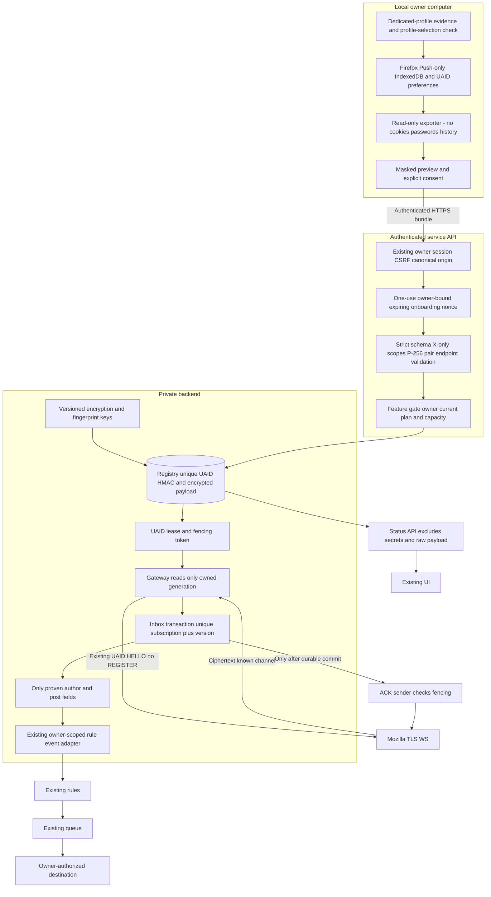
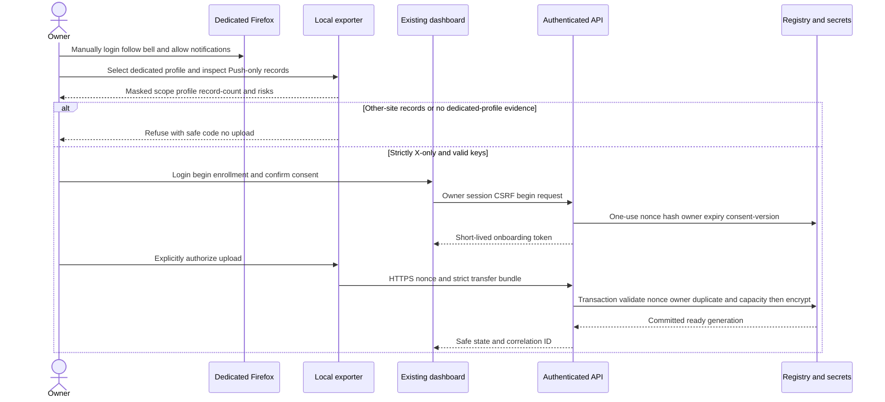
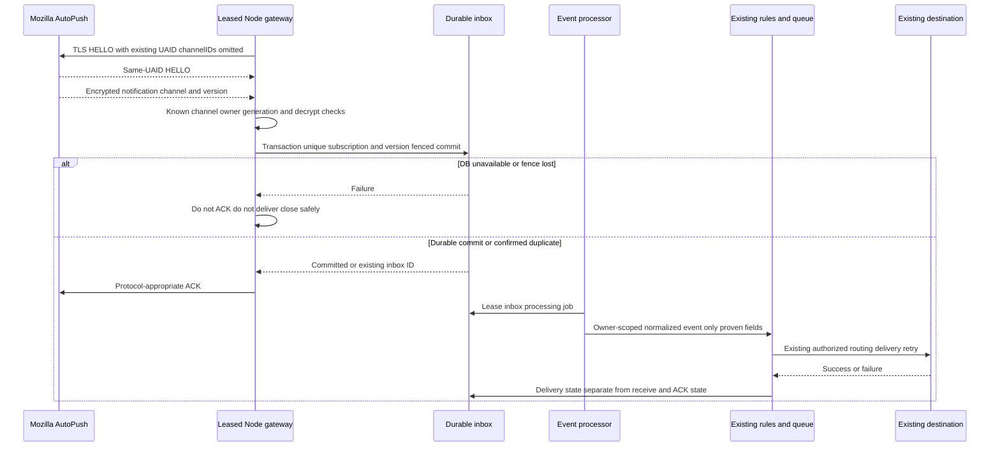
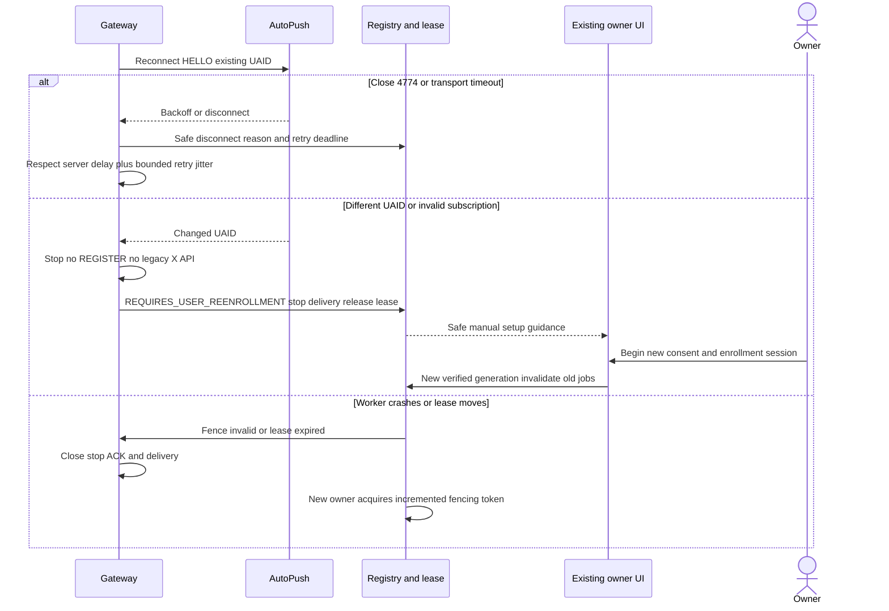

# New X notification system: design review after G0

Updated: 2026-10-14 JST. G0 passed locally; G1 is not passed.
Decision: evaluate Firefox subscription transfer in an isolated Node.js PoC.
The local quota/ledger/API/UI implementation is now present. Genuine Firefox/X
transfer and receipt remain unverified, registration is default off, and capacity
edits do not enable it. No production data, deployment or payment activation
was changed. The diagrams below describe the receiver architecture still gated
by G1; implemented account reservations are separate from that future receiver.

## Alternatives

| View | A: Firefox subscription transfer | B: local receiver agent | C: official X delivery API |
|---|---|---|---|
| Function | Reuse a manually created existing browser subscription | Receive on the owner's PC; forward to service | Contract-supported data retrieval |
| First setup | PC + dedicated Firefox + manual login/bell + explicit consent | PC + audited application + manual login/bell | Service-side API contract; ordinary user onboarding |
| Continued PC use | Intended to be unnecessary; unproven | Required | Unnecessary |
| Secrets | Server holds notification decryption keys and capability endpoint | Keys remain on local device; authenticated event upload | Operator API credentials |
| Security | Receiver can read subscription notifications; UAID collisions and import ownership require controls | Device compromise, update integrity, stopped PC and uploader forgery | Key misuse, provider restrictions and contract scope |
| Cost | Server sockets, CPU, encrypted DB, queue, egress, support; no paid per-post dependency | Similar downstream cost; PC power/availability shifts to owner | Contract/provider fees; incompatible with free-core constraint |
| Operations | Lease/fencing, invalidation, durable ACK boundary, reenrollment | Device versions, uptime, reconnect and local queue | Provider quota/billing and outages |
| Scale | One connection per UAID; Mozilla acceptable load is unconfirmed | Client distributed; service ingestion still bounded | Contract/quota dependent |
| Recovery | Same-UAID HELLO only; changed UAID requires manual reenrollment | Restart local agent; device lost needs reenrollment | Contract credentials and provider recovery |
| Rules/terms | X setup must be manual; Mozilla non-browser operation remains unconfirmed | Manual setup still mandatory; no scripted X website interactions | Current approved API/contract conditions |
| Decision | First candidate; proceed only with genuine PoC evidence | Contingency; do not silently switch architecture | Comparison reference only; never adopted as paid default |

Primary source inspection supports Firefox IndexedDB/PushRecord storage and
public `getKey()` returning public key/authentication data rather than browser
private-key export. It does not demonstrate successful transfer. Current sources
and exact field evidence are recorded in `firefox-source-investigation.md`.
Mozilla's 2017 issue is historical evidence, not current operational permission.

## Existing service integration points

Use existing Discord/NextAuth session and origin/CSRF protections in
`dashboard/lib/automation-server.ts` and the `/api/automation` proxy. Use existing
`src/automation/entitlements.js` and verified billing/donation grants for owner
allowances and supporter status. The YAML/JSON grammar stays in `format.js`;
existing `engine.js`, `evaluation-worker.js`, flow sends, queue and `transport.js`
remain the rule/destination/delivery path. No arbitrary code/HTTP block is added.

Implemented quota integration uses `x-monitor-quota.js`, the shared personal
notification slots and `push-support-grants.js`. It binds existing owner-private
workflow/destination IDs, stores account metadata without Push secrets, and
exposes explicit manual moves in the existing administrator/user plan screens.
It does not implement browser extraction or activate the event receiver/adapter.

The CLI is separate and keeps its legacy TOML; a browser transfer bundle is a new
strict schema. A new production receiver must not import the legacy Twitter
registration module or write cookies to the service. The PoC reuses only the
migrated AutoPush/crypto types with reenrollment authorization disabled.

## Logical architecture

```mermaid
flowchart LR
  U[Owner] -->|Existing login HTTPS| UI[Existing dashboard]
  UI -->|Existing authenticated metadata API| CAP[Implemented quota service]
  CAP --> MON[(Owner/account reservations)]
  CAP --> PERSONAL[(Existing personal notification slots)]
  MON -.->|Future G1-approved subscription binding| REG
  U -->|Manual login and notification settings| FX[Dedicated Firefox]
  FX -->|Normal browser UI| X[X]
  FX -->|Explicit local Push-only export| EX[Auditable exporter]
  EX -->|Offline inspect then consent HTTPS nonce| API[Onboarding API]
  API -->|Owner auth nonce replay validation| REG[(Subscription registry)]
  API -->|Encrypt endpoint UAID CHID private key auth| SECRET[(Encrypted secret store)]
  REG -->|Fenced UAID ownership| LEASE[Lease owner]
  LEASE --> GW[Node AutoPush gateway]
  X -->|Encrypted Web Push| MOZ[Mozilla AutoPush]
  MOZ -->|TLS WebSocket existing UAID| GW
  SECRET -->|Worker-only decryption permission| GW
  GW -->|Known CHID decrypt normalize encrypt persist| INBOX[(Durable inbox unique dedupe)]
  INBOX -->|Committed state| GW
  GW -->|ACK after commit| MOZ
  INBOX --> PROCESS[Event processor]
  PROCESS --> RULE[Existing YAML rule engine]
  RULE --> Q[Existing delivery queue]
  Q --> DST[Existing Discord destinations]
  REG -->|Safe owner state| UI
```

## Detailed boundaries

All secret-bearing APIs use HTTPS in production. Store encrypted endpoint,
UAID/CHID, private scalar/JWK and auth secret; use keyed HMAC fingerprints for
unique/index/lease keys. Public-key material is still omitted from normal owner
status responses when it is unnecessary. Gateway reads require a valid lease
and generation. Worker log fields are fixed error codes, correlation hashes,
states, attempts and durations. The key ring is outside DB; rotation requires
versioned re-encryption and independent audit, not printing decrypted values.

## Onboarding sequence

## Receive sequence

## Failure and reenrollment sequence

State machine: PENDING → READY → CONNECTED ↔ DISCONNECTED; loss of UAID/key
validity → REQUIRES_USER_REENROLLMENT; manual pause → DISABLED; deletion → DELETED.
Every transition checks owner, generation and fenced lease. Deletion first stops
delivery and releases ownership, then removes encrypted secrets; Firefox/X's
remote subscription removal is a separate owner action. Proposed retention is
not silently applied: owner consent text and backup/key destruction periods
need an explicit product decision before live storage.

This is the future subscription connection state machine. The implemented quota
state is separately `ready`, `suspended` or `deleted`. A suspended quota record
retains its pool and personal reservation. `ready` means quota-qualified; it does
not prove an active Firefox/X connection. No qualification transition moves a
reservation to another pool.

## DB and API contracts

| Entity | Contract |
|---|---|
| Onboarding sessions | owner ID, nonce HMAC, expiry, consumed timestamp, consent version; one-use transaction |
| Subscriptions | owner, X scopes, browser/version, encrypted endpoints and key components, UAID HMAC, generation, state; no cookie columns |
| Connection leases | unique UAID fingerprint, worker, fence, expiry; ACK and persistence both check fence |
| Inbox | subscription/generation/channel fingerprint/version unique, encrypted payload/normalized event, processing state and safe failure code |
| Delivery | Extend existing queue/event references; retain existing destination ownership and retry machinery |
| Capacity configuration | Global free default50/supporter default100; separate per-paid-plan eligible flag and per-user special cap, bound to existing plan IDs |
| Capacity reservations | Implemented `automation_x_monitors`, unique owner/account; assigned pool plus existing personal-slot reservation and audit in one transaction; registration default off |
| Permanent supporter holdings | Implemented legacy-count snapshots, verified-payment grants and audited historical/manual operations; stable source identity prevents replay grants; old amounts never reprice old purchases |

Future receiver owner endpoints are onboarding begin, strict bundle import, owner-safe list,
reenroll, disable and delete under the existing authenticated API namespace.
Require canonical origin/CSRF, request size/rate limits, nonce ownership/expiry,
unknown-field rejection, audit-safe responses and IDOR tests. No generic HTTP
request endpoint is created.

The implemented **quota model and existing-screen controls** use
`/api/automation/push-capacity` GET/PATCH and
`/api/automation/push-capacity/plans/{planId}` GET/PATCH. GET/PATCH both require
actual admin identity. Separate revisioned rows prevent changing the meaning of
existing per-user `slotLimit`. Embed the editor in `/admin/notification-plans`.
Updating limits does not enable registration or payment acceptance. Global
free/supporter reductions below occupied reservations are rejected. Plan changes
reevaluate qualification and preserve the assigned pool, including when use is
suspended.
Only existing paid plans may receive the explicitly administrator-classified
Basic-or-higher eligibility flag; unconfigured special quotas default to zero.
The UI shows global free/supporter limits, used/available counts, plan special
capacity, personal allowance/registration/boost counts, permanent supporter
holdings and safe paginated grant/payment/audit history. Admin/owner manual moves
are explicit reviewed choices; there is no automatic-rebalance endpoint.

The user confirmed that one slot is one X account monitored for notifications.
Reservations identify owner plus monitored X author. One Firefox receiver
may carry notifications for several accounts; UAID leases and connection counts
are tracked separately from account-monitoring capacity. A repeated edit of the
same owner/account must be idempotent and multiple destinations must not create
duplicate author reservations. Actual author identity still requires POC-08 proof.

New registration always chooses eligible available **free → supporter → special**
capacity, and consumes the shared personal allowance. The 50/100 default global
limits are administrator-editable; special capacity comes from the existing plan
configuration and does not increase the personal allowance. Ten owners watching
the same account consume ten reservations even if internal retrieval is shared.

Personal capacity is the existing server-managed basic allowance plus canonical
permanent supporter holdings. Existing custom supporter bases and stable native
registration IDs are preserved; the tested legacy basic20 + additional2 remains22
after X opt-in. Old 500–2,500-yen product purchases retain the recorded one-per-
purchase count. New verified JPY500+ payments grant `floor(amount/500)` permanent
slots; monthly cancellation does not remove them. The existing Square financial
unit/amount/refund/expiry calculations remain separate and do not mint a second
personal allowance for a new payment.

X processing priority, minute/day limits and interval follow the current verified
paid contract or configured free plan, independently of pool kind. Legacy
supporter basic registration capacity does not make supporter-pool X processing
use donor quality. The optional plan confirmation interval is stored alongside
existing plan settings (5–10,080 minutes or unset). Existing user interval values
and screen remain; the trusted `useLegacyUserInterval` compatibility/test option
can use them, while the default uses the plan. Frontend input cannot select that
option or grant entitlements.

**Existing reservations never move automatically.** Free vacancies, releases,
plan/capacity edits, reads and delivery eligibility checks preserve pool kind.
If eligibility is lost, suspend use while retaining the pool and personal slot;
suspended reservations remain occupied. An owner or actual administrator can
explicitly POST `/api/automation/x-monitors/{id}/move`. Server-side ownership,
revision, destination capacity, supporter/plan allowance and existing personal
eligibility are checked before one atomic reservation update. Manual moves may
choose any eligible destination; new-registration priority does not constrain
that choice. Settings, account, subscription state, personal slot and current-plan
quality remain intact; failed moves retain the complete source reservation.

Quota changes use global-policy then owner locking. Native registration keeps
the existing owner lock and shared physical notification slots; cadence boosts
continue to consume personal slots. Read-only integrity inspection reports invalid
counts, metadata and orphan mappings without adopting or deleting registrations.
Migration/rollback instructions are in `support-grant-migration.md`; local evidence
is mapped to all17 requirements in `quota-acceptance-matrix.md`.

## Threat and gate review

| Risk | Control and required proof |
|---|---|
| Cookie/password upload or accidental general profile read | Strict transfer schema; explicit path, dedicated-profile evidence, X-only records; unknown fields reject; file-read allowlist |
| Someone else's UAID/keys | Owner-bound nonce, unique HMAC owner binding, validated pair, explicit consent; never trust client owner ID |
| Secret/payload logs | Redacted status; safe fixed error codes; tests for query-string/key/header/body/cause leaks |
| Duplicate workers and split brain | Lease and fencing across receive commit ACK and event generation |
| Lost push or premature ACK | Durable encrypted inbox commit before ACK; failure reconnect and persistent unique dedupe |
| Unknown source identity | No invented post/author/type; retain only proven fields; stop delivery if destination cannot be safely identified |
| Expired/downgraded paid access | Existing verified plan lookup; suspend ineligible use while retaining pool/personal reservation; explicit qualified move only; no client entitlement flags |
| Concurrent admission/movement or invalid counts | Global→owner transaction locks, shared personal slots, CAS and independent real-DB races; audit rollback and read-only anomaly diagnostics |
| Duplicate or repriced historical supporter grants | Frozen recorded legacy counts; verified-payment identity; audited historical references; new500-yen rule never recalculates old amounts |
| DB changes during admin edit | Optimistic compare-and-swap, keep draft after conflict; transaction and bounds checks |
| Mozilla load/terms | Isolated mock load only; current operating acceptability gate before live growth |
| Browser/X changes | Exact versioned PoC source evidence; user reenrollment rather than legacy API fallback |

Self-review: old CLI and service are distinct; all diagrams include Firefox/X/
Mozilla/Gateway/DB/queue/rules/destination; ACK persistence, split-brain, invalid
UAID, other-site subscriptions, nonce replay and owner mismatches have explicit
failure branches. Local quota allocation and UI tests are not evidence of working
X push. Live storage extraction, same-UAID takeover, genuine payload identity and
operating acceptability remain unresolved. No architecture substitutes a mock for
these proofs or promises Chromium compatibility.

## Requirements and work sequence

| Set | Planned implementation and acceptance |
|---|---|
| FR001–010, SEC001/003/005–008 | Existing session + dedicated-profile exporter + strict onboarding; offline validation first, actual Firefox extraction still required |
| FR011–020, SEC002/004/006/009/010 | Node leased gateway, encrypted registry, persistent inbox/dedupe, safe state/owner delivery; not activated before G1 |
| FR021–028 | Existing dashboard/rules/destinations, verified donor flag, global OFF; Chromium remains separate |
| FR029–032, NFR001–010, SEC011/012 | Separate metrics, error correlation, load/resource tests, retention/cost/terms/operating review |
| User capacity additions | Implemented/tested global50/100 defaults, existing-plan special configuration, canonical permanent additions, shared native/X allowance, manual-only moves and safe diagnostics; registration default off |

1. G0 acceptance and immutable phase artifacts (complete locally).
2. This design and primary-source research; review differences and unknowns.
3. Independent offline/loopback-only PoC importer, same-UAID receiver and invalidation
   tests, plus the implemented quota/ledger and existing-screen controls with
   real-MariaDB/DOM acceptance. Exact totals are in the quota acceptance matrix.
4. Actual dedicated Firefox/manual X setup, safe extraction and real transfer
   tests with owner's explicit authorization. Record POC01–09 separately.
5. G1 pass only after critical evidence; then production-integrable encrypted
   subscription registry/leases/inbox/adapter, bind the already implemented
   account reservations, and complete receiver fault/load/authorization regression.
6. User setup/GUI evaluation and authorized supporter beta; observe30–90days
   before general-public stability claims. No donation受付 restart implied.

No schedule guarantees are invented. Quota is tested in independent guarded
MariaDB schemas on the local fixture; receiver protocols use loopback/synthetic
keys. None of those results enables production registration or real payment use.
Initial operating-cost worksheet: connection_count × measured memory/socket cost,
received_events × measured decrypt CPU, retained bytes × backup factor, delivery
egress, monitoring and user support. Measurements at1/100/1000/10000simulated
connections are required before a resource estimate can be called measured;
actual Mozilla load at those levels is not authorized by this design.
