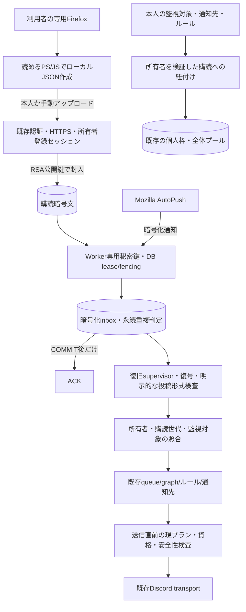

# X通知のサーバー集約・復旧・既存通知との接続

更新: 2026-10-14 JST。過去の決定の根拠は `history-reconciliation.md`。
コードと合成/loopback試験を接続した段階で、実X購読のG1合格ではない。

## 既存機能の再利用

- Phase 0の `autopush` / `crypto` のビルド済みNodeモジュールを読み込む。旧CLI listenerの自動登録処理を呼ばず、X向けHTTPクライアントを新gatewayへ持ち込まない。
- `automation_runs/jobs`、ルール・graph、通知先認可、物理送信レート制限、guardian/fleetの送信保護を再利用する。auto/priceの経路を置き換えない。
- Xの送信資格は現在のプランを再確認する。寄付者バッジや消費プールで処理品質を選ばない。
- `notificationSettings.subscriptionId` は本人の購読UUIDだけを許可。同一購読で複数の監視登録を受けられるが、利用枠は監視登録ごとに消費する。

## 所有権・受信・復旧

`automation_x_push_receivers` と `automation_x_push_inbox` の2テーブルを追加する。
既存の通知ジョブには外部Push接続の所有権や復号前の暗号化通知を保持する領域がないため、接続leaseとinboxだけを分離した。配送ジョブ・プラン・通知先は追加で複製しない。

leaseは所有者・購読ID・購読revision・ランダムtoken・期限でフェンスする。操作は所有者→購読→receiverの順でロックする。
同じ購読へ複数Workerが接続しないよう、DBで所有権を確保してから秘密鍵を使う。期限を越えた更新はSQL待機後も再検証し、期限切れ世代を復活させない。
公開停止、寄付者資格の取消、DB確認失敗は接続中にも検査する。

HELLOのUAIDが違えば `requires_reenrollment` として停止する。新しいUAIDを勝手に保存したり、REGISTERやX内部APIで作り直したりしない。
未知CHIDはX通知の重複判定より先に分岐する。フレーム上限・UUID・version・base64url等の外形と有効なlease/受付資格を検証後、ACK 102（NotDelivered）で破棄し、Xの接続は継続する。
他サイトの復号鍵を持たず、外国CHIDの通知を復号・inbox保存・アプリ処理・payloadログへ渡さない。未知CHIDとXが同じversionでも混同しない。
不正な外形、失効したlease、資格失効は破棄ACKの迂回を許さず従来の停止境界に従う。X通知本文の復号失敗は安全な状態だけを記録する。
ACKは保留中通知を除去するため、破棄した他サイト通知が後でFirefoxへ届くことを保証しない。UNREGISTERや遠隔購読削除は行わない。
ACKの意味は [Mozilla protocol.rs](https://github.com/mozilla-services/autopush-rs/blob/a79b7351a8dd6496e6bd4ef01a07856ce01457f5/autoconnect/autoconnect-common/src/protocol.rs) と [ACK処理](https://github.com/mozilla-services/autopush-rs/blob/a79b7351a8dd6496e6bd4ef01a07856ce01457f5/autoconnect/autoconnect-ws/autoconnect-ws-sm/src/identified/on_client_msg.rs) を参照する。
保存がCOMMITした後だけACKし、同じversionには保存済みのACK判定を返す。DB失敗・期限切れ・所有権喪失時はACKしない。

inboxに置くのは暗号化data・許可した暗号化header・状態・version等で、生の復号payloadや秘密鍵ではない。
アプリ処理が失敗しても受信記録を残し、開始時・再接続後・定期tickで回収する。
取得済みページの処理cursorとcutoffはDBへ保存し、処理が終わったwindowではcursorを0に戻す。前のページでpendingになった通知も次windowで再検討する。

再接続は既存Rust実装に沿い、通常の失敗は5秒から最大5分までの指数待機。AutoPush 4774は最低30分待機する。
追加ジッターは待機を短縮せず、試行数・次回時刻をDBに残す。正しいUAIDで接続できた時だけ解除する。再登録要求は自動再試行しない。

## アプリpayloadと処理間隔

初期アダプターは `notificationType: tweet`、正規の `https://x.com/{handle}/status/{id}`、一致するauthor情報と限定された本文フィールドを持つ明示形式だけを受け付ける。
これは合成fixtureの契約であり、現行Xがその形式を送るという実測結果ではない。未知・DM・余分なフィールドは投稿へ推測変換せず、暗号文のままunsupportedとして区別する。
実Xの形式を確認できるまで、本番に提供可能な完成版と扱わない。

Pushの取得は常時接続で行い、Xを定期ポーリングしない。
まとめ通知では現プランの確認間隔を受信後の処理windowへ使う。プラン値未設定は処理待ちとして残し、固定値を補わない。対象者がリアルタイムを選んだ場合は、確認間隔を待たず処理する。
2026-10-14 JSTの利用者回答「原則1」により、処理方式は `batch` を標準・既定とする。現在の契約プランの確認間隔ごとに、その処理windowまでに保持した通知を全件処理する。ページ分割は処理を進めるためのもので、通知ごとに追加のプラン間隔を空けない。
2026-10-14の追加指示で、利用者画面からリアルタイム通知も選べるようにする。現在の有料契約と管理者のプラン別 `realtime_enabled` 設定で利用資格を確認し、対象者は受信後に確認間隔を待たず処理する。設定の既定はOFF。具体的な対象プランは管理者が設定し、プラン名や末尾 `+` から資格を判定しない。詳しい動作・資格失効・移行は `realtime-notifications.md` を参照する。
既存の利用者別間隔はサーバーの明示互換設定でテストに使用できる。

## 設定と起動境界

今回、本番設定や実秘密鍵は作成・変更していない。rollout・受付・受信Workerの既定は無効で、テストのlocalhost Socketだけを使った。処理方式の `batch` 既定化だけでは本番受信を有効にしない。

| 設定 | 意味 |
|---|---|
| `X_NOTIFICATION_ROLLOUT` | `disabled`（既定）、`supporters`、`public`。先行提供は既存の確認済み `users.is_donor` のみ |
| `X_NOTIFICATION_INTAKE_ENABLED` / 公開鍵設定 | Webのファイル受付。Workerを自動で開始するものではない |
| `ANGELIC_X_REGISTRATION_ENABLED` | 監視登録の受付。提供段階の検査も必ず通す |
| `X_NOTIFICATION_RECEIVER_ENABLED` | 明示した `1` のみWorkerの構成を読み込む。既定OFF |
| `X_NOTIFICATION_RECEIVER_KEY_FILE` | Worker専用の秘密鍵JSONファイルへの絶対パス |
| `X_NOTIFICATION_PROCESSING_POLICY` | サーバー共通の既定方式は `batch`。利用者のリアルタイム選択はDBの希望方式と現在のプラン資格で判定する。環境変数で全員をリアルタイムに変更しない |
| `ANGELIC_X_USE_LEGACY_USER_INTERVAL` | 明示した `1` のみ既存利用者別間隔を互換・テスト用途で使用。標準は現在の契約プランの `confirmation_interval_minutes` |

秘密鍵JSONの形は `{"activeKeyId":"版ID","privateKeys":{"版ID":"RSA private PEM"}}`。公開鍵と対応するRSA 3072〜4096bit鍵を使う。
Webの設定には公開鍵だけを配備し、秘密鍵の内容やWorker用のファイルパスを渡さない。非Windowsでは他ユーザーに読める秘密鍵ファイルモードを拒否する。WebとWorkerが同じOS利用者で動作する環境では、この設定の分離だけでOS上の読み取り権限を分離したとは扱わない。専用アカウント・アクセス権による分離は別途運用受入で確認する。WindowsのWorker運用では専用アカウントDACLも確認する。
旧鍵IDの暗号文が残っている間はWorker専用鍵管理に旧秘密鍵を保持する。鍵の廃棄や実配備はこの変更で実行しない。

Botの既存 `automation/runtime` に停止・起動を接続した。無効時は鍵ファイルを読まず、SocketやDB候補検索も開始しない。
有効化後もguardianの送信許可、共通rollout、所有権、購読世代を通す。通常の自動通知と同様に、shutdownは停止要求と有界の待機で処理する。

## 移行・切り戻し

追加DDLは `migrations/20261014_add_x_push_receiver.sql` と `migrations/20261014_add_x_realtime_processing.sql`。既存のX購読テーブル追加後に適用する。購読や監視の既存行を削除・再配置しない。
本番では承認済みのバックアップ・復旧確認後に適用し、G1と運用承認まで受付・Workerを有効にしない。

切り戻しはまずWorker・登録受付をOFFにし、追加テーブルと購読暗号文・鍵・割当を保持する。
今回の互換UIを残して受信だけ無効にする方式なら、本人の停止・削除・設定確認を続けられる。
`subscriptionId` を理解しない旧コードへ無条件に戻すと設定読み取りに失敗するため、旧コードへ戻す際は互換readerを残す。自動で紐付けを削除して辻褄を合わせない。

## 残る実受入

実購読・実payload・実配送、Mozilla/X側の許容性、長期維持、実認証、WorkerのOS権限・バックアップ運用・退会削除の実環境連携は未確認。
`history-reimplementation-tests.xml` はローカルの回帰証拠であり、本番提供の承認を意味しない。
