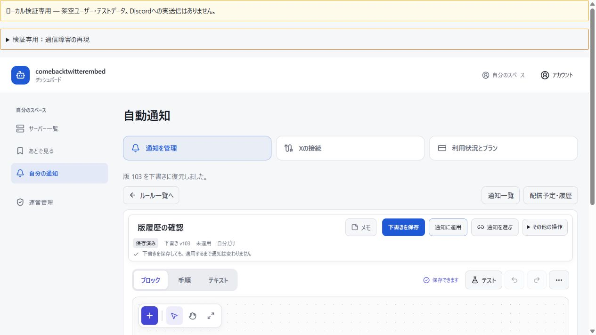

# main 再監査で見つかった追加10件の修正結果

<!-- LOCAL_ACCEPTANCE_STATUS_BEGIN -->
追加10件のローカル検証を確定しました。D2では全185ファイル・2,151成功、失敗・skip・cancel・todo 0、native0です。最終F=e88e744は実F22件と厳密な等価証拠を組み合わせて確認しています。Fで全体を実行したという主張ではありません。main M1=cf22327のCORE一致と実M1配布物のローカル独立レビューを確認しました。M1=cf22327を支援者限定で本番反映し、live47件・application13件と独立レビューで確認しました。
<!-- LOCAL_ACCEPTANCE_STATUS_END -->

監査対象は `2a000c89a293e2ee71ef0c579a63def2ff12cbdb`。追加10件の対応表は [JSON](main-reaudit-remediation.json) です。実装箇所は最終F、テスト宣言は不変の185ファイルへ対応付けました。finalizerでGit原文・作業バイト・mode・宣言を照合しました。旧53件の報告・対応表・XML、今回の監査原本8点、失敗した中間結果は変更していません。

## 10件の修正

| ID | 修正内容 | 検証 |
|---|---|---|
| MAIN-UI-1 | 通知の種類とIDで下書きを照合。同じ数値IDの別種類の通知を削除しても入力を保持。 | 種類間の削除、失敗、停止、同じ種類の削除を実Reactで確認。D2全体試験に含む。 |
| MAIN-UI-2 / MAIN-FRESH-1 | 101件目以降の確認間隔も全ページから再取得し、保存後のCAS基準を更新。取得失敗時は明示再取得まで保存再送を防ぐ。 | 2ページ目の続けて保存、null・例外からの回復、一覧と入力の保持。D2全体試験に含む。 |
| MAIN-FRESH-2 | ルール変更履歴を版番号でページング。従来の配列応答も保持し、100版の切捨てを解消。 | 102版、同時追加、循環cursor、DB障害、選択切替、最古版復元。実React・SQLと画面確認。 |
| MAIN-FRESH-3 | Xの一覧読込と保存を別の世代で管理。受信情報更新で確定した監視操作を取り消さない。 | 作成・編集・停止・再開、遅いread、次の保存のCASを確認。D2全体試験に含む。 |
| MAIN-DATA-1 | 決済履歴を利用者・Square環境・加盟店で絞り、cursorにも同じ範囲を固定。 | 別scope除外、不正cursor、認可・SQL障害、資格情報停止、ページ途中のscope変更。 |
| MAIN-DATA-2 | 通報解決・CAS・監査を同一トランザクションで確定。 | audit・commit失敗のロールバック、競合時の状態と監査の一度だけの確定。 |
| MAIN-POST-1 | 管理設定のcanonical保存が古い親readを無効化。同じAPI内だけで版を単調比較。 | クーポン・プランの遅延read成功／失敗、別APIの同一IDと小さい更新時刻。 |
| MAIN-POST-2 | 通報を表示版番号とchecksumへ固定。審査はその版を開き、旧通報の対象版を推測しない。 | 新版・非公開・撤回後の正しい版、偽装拒否、理由更新と解決CAS。 |
| MAIN-FRESH-4 / MAIN-RUNTIME-MIXED | 全枝の状態から順序に依存せず配信履歴を集約。送信済みと失敗の混在は一部送信。 | 分岐runnerと状態組合せをD2全体2151件と実F22件で確認し、Fへの等価引継ぎを独立承認。 |
| MAIN-FRESH-5 | jobの直接変更とrun履歴を同じトランザクションで更新。初期jobなしの停止、親子の全ページ、UUIDの内部照合も修正。 | 102子・後続ページEIOの全体rollback、競合、ACK・unknown・将来予定の保持。D2全体2151件と実F22件、独立レビュー。 |

## 実行ソースと最終コードを区別する

| 対象 | 正確な記録 |
|---|---|
| 全体試験の実行ソース | D2 `d2e792d30a44723e603869b27970b05597d51a9d` |
| 最終コード | F `e88e74412905987352af0ae7cec665963fc737d0` |
| 実際のmain | M1 `cf22327dc39964194fbc2c48d8002366cfb22613`。rootがPR51を統合。finalizerでFとのCORE一致も確認済み。 |
| Fとの差分 | `flow-history.js` の整形・11 JSDocのみ。正確なSHA-256は `aa1580814a0289b029a17a1805485391026a0b68ed8418a6250e1c637b95f6f4`。 |
| Fの追加実行 | 同じ22ケースのflow SQL試験。Fで全185ファイルを実行したことにはしない。 |

<!-- ROOT_MATRIX_RESULT_BEGIN -->
[D2全体XML](main-reaudit-evidence/root-d2-full185-2151-tests.xml)、[最終summary](main-reaudit-evidence/root-d2-full185-2151-progress.log)、[native receipt](main-reaudit-evidence/root-d2-full185-native-exit.json)は、185ファイル・2,151成功、失敗／skip／cancel／todo 0、native終了コード0です。内訳はleaf2,090件と親61件。[root記録](main-reaudit-evidence/root-d2-185-closed-acceptance.json)も実行ソースをD2に固定しています。safeな接続取得retryはspec1回・outer0回で、記録を合算しません。

[最終Fの全10件証明](main-reaudit-evidence/independent-final-F-e88e-certificate.json)は、32ファイルのcanonical Git・作業バイト・modeとCORE8、schema/prisma69パスのc630からの不変を確認しています。[等価証拠](main-reaudit-evidence/independent-closed-D2-format-carry-plan.json)により、他31のレビュー対象、残りのCORE、全185テストと依存ファイルが不変であることを確認しています。Fで全体を実行したという主張はしません。
<!-- ROOT_MATRIX_RESULT_END -->

[全実行ASTの独立比較](main-reaudit-evidence/independent-nullable-style-equivalence-assessment.json)は、TypeScript・Espree、SQL、template、regex、文字列、exports、ソース表記への依存を確認しています。[型の証拠](main-reaudit-evidence/flow-style-effective-type-equivalence.json)は同じprogram内の11関数を両方向に比較。通常診断0件、strictNullChecksの既存527件も増えていません。実際のnullableな戻り値を狭く書き換えて一致させていません。

[適用済みFの22件XML](main-reaudit-evidence/independent-F-flow22-tests.xml)は22成功、失敗・skip・cancel・todo 0、57,402.6721ms、native0。[cleanup証明](main-reaudit-evidence/independent-F-flow22-closed-cleanup.json)で専用schema残数0、所有者不明の既存7 schemaを変更していないことを確認しています。Fのroot/dashboard型検査、lint、node構文、diff検査はroot実行成功としてF証明に記録されています。

## CIの結果と誤検知を分ける

D2に実際にあったJSDoc・indent・Prettierの3指摘は、最終Fのローカル対策と検査へ反映しました。[現在のFチェック116927587463](main-reaudit-evidence/current-F-ci-check-116927587463.json)は依然action_requiredです。`lockFlowWorkflows` と `refreshWorkflowFlowHistory` の2件について、[公式の未改変ruleによるtriage](main-reaudit-evidence/F-async-findings-false-positive-triage.json)をrootが確認し、誤検知と判断しています。

ruleは直下のawait・returnを扱う一方、for内のawaitと呼出し元のtransactionへ伝わる拒否を追跡しません。実際のproduction pool transaction wrapperと実helperを使うcallback driver doubleの8対照で、拒否時の同じErrorの伝播、COMMIT0・ROLLBACK1、release／rollback失敗時のdestroy、UnhandledRejection0を確認しています。このtriageは実SQLを実行していません。実SQLでのrollbackはD2全体とF22件に含まれます。catch/rethrow追加、rule無効化・除外は行っていません。

変更していない5ファイルで起きる[旧vendor null-handler中断](main-reaudit-evidence/codacy-0769-vendor-rule-findings.json)は別の解析不具合です。現在の2件をその中断だけで説明しません。クラウド成功・全CI成功、security scanの成功とは記録していません。

## ローカル展開準備と本番の境界

[REV4の独立ローカル202件](main-reaudit-evidence/independent-ops-REV4-F-local202-review.json)、[固定記録](main-reaudit-evidence/ops-rev4-F-approved-local-freeze.json)、[F専用契約](main-reaudit-evidence/ops-rev4-F-local-source-contract.json)、[rootソース証明](main-reaudit-evidence/root-reviewed-F-e88e-attestation.json)を保存しています。これらは準備段階の証拠です。続いて実M1から生成した配布物は、[独立したactual202レビュー](main-reaudit-evidence/independent-actual-M1-artifact-final-review.json)と[担当freeze](main-reaudit-evidence/actual-M1-artifact-author-freeze.json)を通過しました。実M1の24ファイルを排他的に転送し、読み戻しhashを確認しました。[stageとbackup](main-reaudit-evidence/production-M1-closed-stage-and-backup-proofs.jsonl)では旧版・新版それぞれ17検証が成功し、両stageプロセスを終了。78表のトランザクション整合backupを1回作成してから切り替えました。

[10:27 UTCの本番読み取り証拠](main-reaudit-evidence/production-readonly-before-F-10-27.json)は旧c630、worker678911、全14シャードready、lease active、Webも同じ版、支援者限定でした。6プランと個別の5分設定を保持しています。これはF／M1の本番反映ではありません。続く本番切替でM1 `cf22327dc39964194fbc2c48d8002366cfb22613` を確認しました。実OAuth、新しい実X投稿からDiscordへの配信、実Square決済は未検証のままです。

## 画面確認

[ローカルの実React・API・使い捨てSQLの記録](main-reaudit-evidence/browser-history-fdde-scenario.json)では、履歴50・100・102件を表示し、版1を新しい下書き103へ復元しました。Discordは模擬です。証拠の実行ソースは旧fddeで、対象UI6コンポーネントの不変をfinalizerで照合済みです。最終runtimeのブラウザー全体試験や実OAuthの証拠にはしません。

## 失敗・中間結果を保持する

| 過去のソース／試験 | 記録 |
|---|---|
| fdde | 初期jobなしの削除とprojectorで実SQL deadlock。後続修正。[証拠](main-reaudit-evidence/independent-runtime-fdde-followup.json) |
| d6 | 監視の割当先変更とpackage revokeの実deadlock。後続修正。[RED XML](main-reaudit-evidence/runtime-monitor-revoke-d6-red.xml) |
| f915全体run19271 | obsolete fixtureのJavaScript待機循環で未完了・exit1。実InnoDB deadlockとは区別。[診断](main-reaudit-evidence/root-f915-failed-diagnostic-v2.json) |
| 0769全体run47219 | 2,126中2,120成功・6失敗、exit1。native TCP3件、実際の親子cleanup回帰1件、失敗した親2件。[閉じたXML](main-reaudit-evidence/root-0769-closed-failed-184-tests.xml)、[分類](main-reaudit-evidence/local-db-0769-closed-failure-classification.json) |
| 別ソースのfocused | UI28・data57・独立43+3、runtime42/58/16、casefold前150などは、その時点の個別証拠。最終2151へ合算しない。 |

親子cleanupは、100件の初期候補と主キー100件ページを区別して全対象を同一transactionで更新し、102子の後続ページEIOも全体rollbackを検証しました。旧legacy SQLの期待値とowner-CASの試験は保持しています。UUIDの正規化は内部mutexキー・run照合だけで、外部ID・namespaceKey・JSONは保持しました。[担当d2報告](main-reaudit-evidence/runtime-author-d2-cascade-case-report.json)、[独立59件](main-reaudit-evidence/independent-final-d2-cascade-case-admission.json)

テストhelperのretryは、SQL前の条件に合うloopback native取得だけ、最大3回・50/100msです。SQL・work・commit・assertionの再実行はしません。19個別対照を含みます。[Windows TCPの因果境界](main-reaudit-evidence/local-db-native-connect-causal-boundary.json)では、OS固有原因の121／10060までは特定できていません。接続取得の対策でOS原因も直ったとは記録しません。

<!-- LOCAL_FINALIZATION_GATE_BEGIN -->
Guarded finalizerでD2の閉じたXML・summary・native receipt、185のraw test/mode、44件の指摘対応と7件の基盤テスト宣言、F32・CORE8・schema69、F22、等価／型証拠、ローカル202、main M1のCORE一致、実M1配布物のローカルレビューを照合しました。失敗履歴とCI action_requiredは保持しています。転送・stage・本番の閉じた証拠を追記しました。実通知の検証範囲は以下のままです。
<!-- LOCAL_FINALIZATION_GATE_END -->

## 支援者限定の本番反映

[workerを先に準備した切替](main-reaudit-evidence/production-M1-closed-promotion.jsonl)後、[live47件](main-reaudit-evidence/production-M1-closed-live47.jsonl)と[application13件](main-reaudit-evidence/production-M1-closed-application13.json)がすべて成功しました。[名前付き検証と保存状態](main-reaudit-evidence/production-M1-pinned-proof-details.json)で、DBの前後fingerprint一致、DDL追加0、全14シャードready、leaseとheartbeat、BotとWebのM1一致を確認しています。[独立した本番レビュー](main-reaudit-evidence/independent-M1-production-final-review.json)もCLEANです。

[10:59 UTCの常駐確認](main-reaudit-evidence/production-M1-resident-after.json)はworker459285とM1のWeb、支援者限定・受付・登録・受信有効、batch、6プランと個別5分設定の維持を示します。bootstrap v2完了と既存の利用対象1件のfresh listeningを確認しました。この既存受信状態は、新しい実X投稿からDiscordへの配信を確認したという意味ではありません。実OAuth・新しい実X投稿の配信・実Square決済は未検証です。D2全体2,151成功と実F22件／等価引継ぎ、クラウドaction_requiredの2誤検知は上記のとおり区別しています。

報告書と証跡の掲載先：[文書PR #52](https://github.com/lovetwice1012/comebacktwitterembed/pull/52)。本番の稼働コードはM1 `cf22327d` です。
