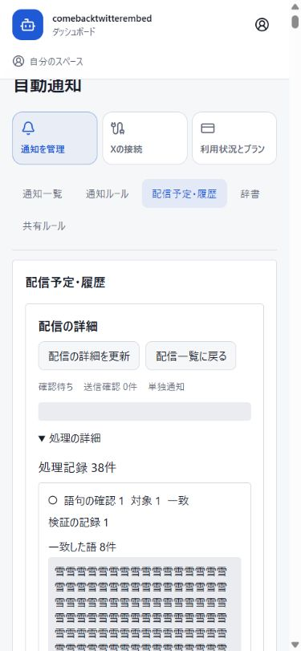

# 自動通知・自動展開 53件の修正対応

2026年10月16日。監査50件と追加のR32-1、S34-1、S34-2を、実装と自動試験へ対応付けた。対象はP1 12件、P2 41件。**V7候補のローカル検証は完了**。固定b4c77bfの176試験ファイルで2,066件が成功し、失敗・skip・cancel・todoは0件。旧V6ソースの175試験ファイル・2,056件成功は過去のローカル結果として保持する。V6本番反映は通知起動の失敗で不採用となり、互換版へ切り戻した。V7の全176試験はローカル結果として記録し、実bundle・本番常駐と実着信は引き続き確認待ちとする。

機械可読の対応と試験の実際の宣言名・行番号は [saturation-remediation-map.json](saturation-remediation-map.json) に保存した。全53 IDに実装箇所と存在確認済みの自動試験を対応付けており、未対応IDは0件。試験宣言の存在と、最終ソースでの実行成功は分けて記録する。

## 対象と証拠

| 項目 | この文書を作成した時点の状態 |
| --- | --- |
| 実装の比較基準 | `f241aa268344b407adf64735f1d8bd3c3aa12968` |
| V7の固定候補ソース | `b4c77bf99b7db3579dea54b966c43fb1531b8dba` |
| ローカル検証したソース | b4c77bfの176試験ファイルで2,066件成功。現在HEADもCORE8と固定ソースが一致 |
| ローカル検証済みソースSHA・全ソースハッシュ | `b4c77bf99b7db3579dea54b966c43fb1531b8dba`。Git原文SHA-256・観測作業バイト・CORE8を照合しJSONへ記録。旧1d32f10を過去記録として保持 |
| 最終main SHA | V7は未統合。PR48を含む旧mainは `e661ea65436606f6177d9917f7cfb1861bcc1c39`。PR49 draftは全176試験後に判断する |
| V7本番SHA・配備証拠 | 未確認。保存済みの最新証拠では互換版 `f241aa268344b407adf64735f1d8bd3c3aa12968` へ切り戻し済み |
| 過去の全175試験ファイル | 1d32f10の2,056件成功・失敗0・skip 0、型検査・lint成功を保持。V7や本番の合格へ転用しない |
| V7全176試験ファイル | 2,066件成功、失敗0・skip 0・cancel 0・todo 0。[今回のXML](evidence/frozen-176-tests.xml)を保存。b4 root型検査・変更箇所lint成功、dashboard検査は不変treeの既存成功を保持 |
| V7起動修正の独立確認 | b4c77bfで33/33成功、新規managed-data 10ケース。全176試験・本番常駐とは別証拠 |
| 独立データ確認 | [1回目](evidence/data-review-1.md)・[2回目](evidence/data-review-2.md)ともclean。変更した履歴UIは別レビューも完了 |
| 追加の全履歴UI | [独立React試験70件](evidence/history-ui-review.md)と実SQL・ブラウザー結合確認が成功 |
| 実OAuth・新しいX投稿からDiscord着信 | 未検証 |
| 実Square決済 | 未検証。確認のための課金は行っていない |

原監査は別の元checkout内の `docs/audits/supporter-readiness-2026-10-16/saturation` にある。master50件、31周の既知指摘への拡張、32周の復旧証拠、34周の2件を読んで対応を作成した。元資料の絶対パスとSHA-256はJSONに記録し、元資料は変更していない。旧 [PR47の6件修正報告](../supporter-readiness-remediation-2026-10-16.json) と旧試験XMLもその時点の記録として保持し、今回の53件合格の根拠には使わない。

## V6の不採用と切り戻し

以下の時刻は2026年10月16日UTC。JSTは9時間後。保存済みの観測を記録したもので、V7の本番確認ではない。

| 時刻 | 保存済みの結果 |
| --- | --- |
| 02:35:43 | V6 e661ea65のWorker・Web識別、Gateway 14/14 readyを確認。別のHTTP検証も33項目成功したが、通知lifecycle完了を確認できていなかった |
| 02:37:12 | 既存のeligibleなX監視はready 1件・donor 1件だったが、受信状態はstopped、受信leaseなし。[受信証拠](evidence/v6-stopped-receiver.json) |
| 02:39:38 / 02:43:10 | ready.initializeが旧復旧完了記録のv2更新中に失敗。V6の `recoveryBootstrap.js:178` がBOOTHの管理共有dataディレクトリとleaf aliasを再検査し、symbolic-link拒否で通知用background処理の開始に到達しなかった。[起動記録](evidence/v6-runtime-startup-probe.json)・[配置確認](evidence/v6-bootstrap-layout.json) |
| 02:48:24 | 互換版f241aa26へ切り戻し、Worker→Webの順で識別・lease・heartbeat・14/14 readyを確認。9列と4移行記録を保持し、DB復元なし。[切り戻し](evidence/v6-rollback-state.json) |
| 02:49:59 | 同じ既存X受信がlisteningとなり、現在の受信leaseと更新時刻を確認した。新しい監視・支払い・メッセージは作成していない。[既存受信の回復](evidence/v6-floor-receiver.json) |

V6を本番合格とはしない。初期constructor probeは `withDatabaseTransaction` を持たないfixtureであり、表示された `X_PUSH_WORKER_KEY_UNAVAILABLE` を鍵不良の根拠にしない。実際の起動中断は復旧処理のBOOTHパス検査で確認した。[解釈と証拠一覧](evidence/v6-rejection-rollback-summary.json)に区別して残した。

V7は旧完了記録のBOOTH読込・module読込だけを省略する。旧SQL一覧とscopeごとのcheckpointは保持し、未実施・途中の新着／価格通知を必ず読み取る。途中の読取失敗はfence v2完了を許可せず、再起動時は完了済みscopeを飛ばして残りだけを再開する。新規・未完了のBOOTH復旧では、従来の厳格なリンク検査と起動停止を維持する。

当初の6fa2系修正は、旧complete記録だけを根拠に不足SQL scopeまで省略するP2が独立確認で見つかった。[棄却した候補の証拠](evidence/legacy-scope-rejected-variant-witness.json)を保持し、clean結果へ数えない。修正後のb4c77bfは、歴史的な3-scope記録、欠落／途中の新着・価格scope、実SQLと再開、実BOOTH provider・実filesystemのdirectory/leaf alias、durable write失敗、実ready.initializeの11 workload開始監視、新規・未完了時の停止を含む新規10ケースと関連試験33件を通過した。[独立確認](evidence/startup-source-b4c77bf-review.json)・[修正後の再現](evidence/legacy-scope-fixed-witness.json)はローカル証拠で、11個の本番処理が起動した証明ではない。

旧[175ファイルXML](evidence/frozen-175-tests.xml)、[修正報告の当時の原文](evidence/historical-local-175-remediation.txt)、[対応表](evidence/historical-local-175-remediation-map.json)は過去のローカル成功として保持する。V7の結果、実bundle、本番起動の代わりには使わない。

## 指摘ごとの対応

以下は53件の実装と自動試験の対応である。R32-1以外の対応は維持した。現在の各IDとcoverageのpassed状態は、今回のb4c77bf・176ファイルのローカル結果へ結び付けた。旧1d32f10・175ファイルの記録は `historicalVerification` に保持し、R32-1の新規起動試験も今回の全試験へ含めた。

| ID | 優先度 | 実装内容・通常経路 | 自動試験 |
| --- | --- | --- | --- |
| R1 | P1 | 同じ取得回で見つかった通知を不変の通知ウィンドウへまとめ、再起動・再試行後も元の確認間隔で処理する。 | [A38](#a38)、[A18](#a18) |
| R2 | P1 | 送信開始時の試行加算を再利用し、Discordの拒否応答で二重加算しない。結果不明・一部送信は自動再送しない。 | [A38](#a38) |
| R3 | P1 | 割当済みルールの未適用・停止・削除を監視状態へ反映し、実際に待機している理由を表示する。 | [A27](#a27) |
| R4 | P2 | 非JSON・通信障害・不正な成功応答を安全な画面メッセージに変換し、再読込で回復できる。 | [A27](#a27)、[A15](#a15) |
| R5 | P2 | 監視削除の失敗を固定した日本語・英語の案内に変換し、内部例外や他人の情報を公開返信へ出さない。 | [A02](#a02) |
| R6 | P2 | 共有取得時刻とは別に、各登録者の確認間隔から次回確認時刻を返す。 | [A38](#a38)、[A01](#a01) |
| N1 | P1 | Discordの既存DM・Webhook通知先をgraph送信へ引き継ぎ、不正な1件が別の送信を止めない。 | [A32](#a32) |
| N2 | P1 | 通知の種類とIDで編集状態を分離し、別通知へ前の通知先や確認状態を持ち越さない。 | [A20](#a20) |
| N3 | P1 | 単独の直接展開もproviderの展開処理を使い、画像・リンク・表示設定を保持する。 | [A32](#a32) |
| N4 | P2 | 予約をjobとleaseへ結び付け、送信前と確認できる未送信分だけを異常終了後に回収する。 | [A30](#a30) |
| N5 | P2 | 物理送信の各通直前に権限・NSFW・送信先・安全状態を確認し、送信済みACKと未送信分を区別する。 | [A30](#a30) |
| N6 | P2 | 除外・待機・期限切れと各経路の理由を永続履歴へ投影する。大きな履歴は原記録を全件ページ取得する。 | [A32](#a32)、[A17](#a17)、[A09](#a09)、[A10](#a10)、[A14](#a14) |
| N7 | P2 | 通常方式の価格通知は通常Bot展開の引渡し対象とし、直接展開の二重展開抑止だけを残す。 | [A30](#a30) |
| N8 | P2 | 履歴詳細の選択・画面状態を世代管理し、遅い旧応答で別配信を操作対象にしない。 | [A33](#a33) |
| N9 | P2 | ルール・通知先・辞書の全ページを読み込み、後続ページも選択・検索へ含める。循環cursorは安全に拒否する。 | [A33](#a33)、[A05](#a05) |
| T1 | P1 | 検知済み新着の本文と初回観測時刻を永続化し、上流一覧から消えた後も外部取得より先に保留分を処理する。 | [A43](#a43)、[A44](#a44) |
| T2 | P1 | 辞書の一致診断を実行器の上限に合わせ、8件・9件以上の一致でも判定を続ける。 | [A32](#a32) |
| T3 | P1 | 通常複製と通知別複製に表示中ルールのscopeを使い、共有閲覧者の隠れた複製を許可しない。 | [A33](#a33) |
| T4 | P1 | job内の空の辞書情報に依存せず、不変ルール版の辞書bindingと配布元の安全停止を確認する。 | [A30](#a30) |
| T5 | P2 | 辞書保存版ごとの配布元と複数依存元を保持する。名前変更・更新・編集・復元・再導入後も固定した各版の安全停止を確認する。 | [A31](#a31)、[A24](#a24) |
| T6 | P2 | 初回観測を起点とする最大待機期限をgraphの保存・再読込・送信判定まで引き継ぐ。 | [A32](#a32) |
| T7 | P2 | SteamのAPIとHTMLの割引・参照価格を揃え、取得不明をセール終了と扱わず再通知を防ぐ。 | [A45](#a45)、[A44](#a44)、[A48](#a48) |
| T8 | P2 | Discord価格登録で入力された全条件を検証し、不正な第2条件を黙って捨てず登録前に拒否する。 | [A44](#a44) |
| T9 | P2 | 履歴復元時に保留中テキストと旧ファイル読込を無効化し、復元した版からエディターを開き直す。 | [A33](#a33) |
| T10 | P2 | 使われていない削除済み通知先・辞書bindingを保存・復元時に除き、使用中の資源は検証する。不変の旧版は変更しない。 | [A31](#a31)、[A40](#a40) |
| T11 | P2 | 割当・解除の全経路で監視版を進め、版と元割当を照合して古い画面からの解除を拒否する。 | [A31](#a31)、[A21](#a21) |
| S4-1 | P1 | 固定文字列startではなく不変ルールの実際の開始IDを使い、旧未処理状態も開始条件を確認する。 | [A32](#a32) |
| S4-2 | P2 | 期限切れの集約メンバーだけを除き、健全なメンバーの期限・通知可能時間・手動予約の下限を保持する。 | [A32](#a32)、[A17](#a17) |
| S4-3 | P2 | 共有リンクとパッケージ詳細の応答を選択世代へ結び付け、古い成功・失敗で現在のIDや共有キーを上書きしない。 | [A33](#a33) |
| S4-4 | P2 | 不変な配布元版・最初のfork版を根拠にライセンスと出典を保持する。通常複製・復元・辞書共有・再導入も検証し、同じ所有パッケージの改訂は自己forkを作らない。 | [A16](#a16)、[A06](#a06)、[A07](#a07)、[A24](#a24)、[A25](#a25)、[A29](#a29) |
| S4-5 | P2 | 個人画面で本人所有の既存チャンネル監視を編集する際、保存済みguildと宛先を使って本人の現在権限を検証する。 | [A19](#a19) |
| S4-6 | P2 | 監視解除・再接続で不要になったXセッションを閉じ、別監視で使用中の接続と暗号化受信記録を保持する。 | [A42](#a42) |
| S5-1 | P2 | シミュレーターを同じgraph実行器へ揃え、時間経過・経路の完了・合流の順序を実処理と一致させる。 | [A32](#a32)、[A13](#a13) |
| S7-1 | P2 | 永続的なサイズ・形状・メンバー数超過をロールバック後に失敗確定し、正常な後続を進める。履歴が大きい正常処理は全記録を保持してページ表示する。 | [A32](#a32)、[A03](#a03)、[A11](#a11)、[A09](#a09)、[A10](#a10)、[A12](#a12)、[A14](#a14) |
| S7-2 | P2 | 別辞書としての取込保存前に未保存変更の破棄を確認し、取消時は編集と取込の両方の入力を保持する。 | [A33](#a33) |
| S7-3 | P2 | Xを含むすべての割当先を適用確認へ表示し、通知別コピーではXの版と既存設定を保持する。 | [A31](#a31)、[A33](#a33) |
| S8-1 | P2 | 登録保存とDiscord確認返信を分離し、返信失敗や保存結果不明で使用中のWebhookを削除しない。チャンネルの作成・採用・後片付けを直列化する。 | [A44](#a44)、[A04](#a04)、[A23](#a23) |
| S8-2 | P2 | 同一所有者・対象・チャンネルの再登録は既存登録と枠を再利用し、同時実行や旧Webhook修復でも重複登録しない。 | [A44](#a44)、[A04](#a04)、[A23](#a23) |
| S9-1 | P2 | 部品・ルールファイルの読込を対象の内容と世代へ結び付け、選択変更・復元・unmount後の旧読込を破棄する。 | [A33](#a33) |
| S12-1 | P2 | Discordチャンネル登録前に登録者とBotの閲覧・送信・Webhook管理権限を確認し、失敗時は通知・枠を作らない。 | [A44](#a44) |
| S12-2 | P2 | 価格登録の遅い処理より前に非公開deferを行い、モーダルを開く操作の応答方式は保持する。 | [A44](#a44) |
| S14-1 | P2 | BOOTHの未認識HTTP200ページを取得失敗として扱い、明示された空ショップだけを空基準にする。 | [A45](#a45)、[A44](#a44) |
| S18-1 | P2 | 再開・有効な設定保存・再登録で、管理済み／旧通知先の有効状態・保存ID・実Webhook宛先・実行者権限を確認する。停止・削除と本人DMは維持する。 | [A19](#a19)、[A40](#a40)、[A22](#a22) |
| S20-1 | P2 | 適用対象集合のトークンと各登録者・元設定・割当のロックを同じトランザクションで照合し、確認外の通知が増えた場合は競合にする。 | [A31](#a31)、[A33](#a33) |
| S20-2 | P2 | 同一Xアカウントの登録再送は、明示指定した設定が同じ場合だけ既存登録として成功させる。変更は編集操作へ案内する。 | [A31](#a31) |
| S21-1 | P2 | ルール削除を全割当先の停止・解除とgraph処理の失効へまとめ、通知登録・枠・送信済み／結果不明の記録を保持する。 | [A39](#a39) |
| S22-1 | P2 | 別パッケージの改訂を始める前に未保存共有内容の破棄を確認し、取消時は元の入力を保持する。 | [A33](#a33) |
| S24-1 | P2 | 共同編集者と実際の通知所有者を分けて権限確認する。ルール適用・再開は全割当所有者、追加割当・監視再開・再登録は対象所有者を確認する。 | [A19](#a19)、[A40](#a40)、[A22](#a22) |
| S24-2 | P2 | 成功応答のID・版・削除状態を先に反映し、後続取得だけを再試行する。新規ルールの応答読込は作成トランザクションに含め、失敗時は全体を取り消す。 | [A26](#a26)、[A33](#a33)、[A34](#a34)、[A14](#a14) |
| S26-1 | P2 | X編集の競合後は入力を保持し、明示的な再確認で変更項目だけを最新設定へ重ねる。旧通知先・ルール・受信情報を丸ごと再送しない。 | [A41](#a41) |
| R32-1 | P1 | 元の観測・受信時刻と復旧境界を保持する。旧完了記録でも不足・途中のSQL scopeを再開し、完了済みBOOTH snapshotだけを再読込しない。新規・未完了は厳格なリンク検査を維持する。 | [A28](#a28)、[A43](#a43)、[A46](#a46)、[A47](#a47)、[A49](#a49) |
| S34-1 | P2 | 解約確認と要求を表示済み契約ID・申込IDへ結び付け、正規の状態再取得で再確認を求める。サーバーも所有者ロック下で同じ契約を照合する。 | [A35](#a35)、[A37](#a37) |
| S34-2 | P2 | 寄付履歴を受付時刻とIDの安定cursorで過去へ取得し、100件の未送信見積りより古い確定支払いも表示する。決済照合cursorと支援枠を変更しない。 | [A36](#a36)、[A08](#a08) |

## 全履歴の読込

N6とS7-1の追加対応では、小さな履歴の既存配列を維持し、大きな履歴の投影を既存のstep・batch・member・job記録への索引で保持する。履歴APIはrunとsourceRevisionへ結び付けたcursorで全件を返す。1ページの件数・bytesを制限しても、残りは次ページから読める。単一の大きな診断項目も欠けずに返し、語、位置、分類、理由、独自フィールドを切り詰めない。

画面は利用者が履歴を開いたときに読み込み、続きの失敗時は表示済み記録とcursorを保持する。通知の件数と処理記録の件数を分ける。選択、scope、active状態が変わった応答を採用せず、403/404では閲覧権限を失った旧記録を取り除く。処理履歴のGETに通知変更権限を与えず、履歴読込の失敗で保存済みPATCHを再送しない。

自動試験には、52ノードの実worker経路、255文字の一致語、16MiB超の全診断、全ページの件数とdigest一致、旧配列・300KiB超の単一記録、再起動、cursor競合、所有者・guild認可、50行の遅延読込、複数runの共有原記録読込を含めた。これらの試験宣言を対応表へ追加した。**追加履歴UIは独立試験70件と実SQL・ブラウザー結合確認を通過した。** 700件の記録を使い、ページ追加、更新競合409と読み直し、390px幅での位置表示・横はみ出しなしを確認した。

## 移行と保持するデータ

比較基準から追加した移行は4件で、既存4テーブルのNULL許容9列と4移行記録はV6で適用済み。切り戻し後も保持した。V7に新しいDDLはない。新しいテーブルは作らない。

| 既存テーブル | 追加列 | 列数 |
| --- | --- | ---: |
| automation_rate_reservations | job_id、lease_token | 2 |
| automation_dictionary_revisions | source_package_id、source_package_version、origin_reviewed、package_dependencies_json | 4 |
| automation_revisions | source_package_id、source_package_version | 2 |
| automation_package_versions | package_dependencies_json | 1 |

移行ファイルは `20261016_bind_automation_rate_reservations`、`20261016_add_dictionary_package_provenance`、`20261016_add_workflow_package_provenance`、`20261016_preserve_dictionary_package_dependencies`。各SQLのSHA-256はJSONへ記録した。R1の既存 `20261016_add_auto_watch_notification_window.sql` は比較基準に含まれるため、この4件・9列には数えない。

ルール・辞書本文と既存checksum、通知登録・通知先・購読、プラン・課金条件・契約・支援履歴、利用枠の保有と手動移動、下書き、暗号化受信・ACK、送信済み・結果不明の記録を保持する。由来の補完は証拠から分かる関係だけを新列へ記録する。旧ルールの配布元版が不明な場合はNULLを保持し、現在の導入版から推測しない。編集・復元を続けられる一方、公式の複製・書き出し・再公開には保存版の由来確認を求める。外部ファイルの従来のbundle形式と明示的な権利確認は維持する。

旧辞書の由来が失われている場合はDDL前の確認で止め、バックアップと配布・導入資料に基づいて確認する。新しい複数配布元のJSON列はNULLから関係を推測して埋めない。安全停止は、各保存版が固定参照する配布元へ適用する。

切り戻しでは追加列・由来と依存関係のJSON・予約・既存データを保持する。列削除やDB復元で戻さず、互換性のあるコード版を選ぶ。旧コードに戻す場合は修正前の問題も戻るため、既存の復旧lease・手動切り戻し・通知隔離を確認する。

## 最終確認と本番記録

過去の1d32f10固定ソースの[全175試験XML](evidence/frozen-175-tests.xml)、[通知先・providerレビュー](evidence/provider-review.md)、[runtimeレビュー](evidence/runtime-review.md)、[履歴UIレビュー](evidence/history-ui-review.md)、[配布準備レビュー](evidence/ops-preparation-review.json)を保存した。独立した長語ケースでは4,113件・25,765,177 bytesの全履歴を104ページで取得し、不変の原記録と完全一致した。

配布手順の独立レビューで見つかった同名ファイルの上書き競合も、排他作成と同一ハンドルでの読み戻しへ修正した。[修正版の独立レビュー](evidence/exclusive-uploader-review.json)と[42件の試験証拠](evidence/exclusive-uploader-tests.json)を保存している。旧配布資材と旧SSHヘルパーは保持した。これらは準備資材の確認であり、実際のmainから作る配布物は別途検証する。

全試験は `NODE_ENV=test` と明示した隔離MariaDB `127.0.0.1:33621` を使用する。実Discord、X、Square、OAuthの代わりにfixtureを使う。

`scripts/run-supporter-readiness-acceptance.cjs` は既存のPR47用XMLを既定出力先にするため、今回の実行では `SUPPORTER_READINESS_TEST_REPORT` に今回専用の出力先を指定した。固定ソースで全試験、root/dashboard型検査、変更箇所lintを実行し、ログ・件数・失敗・skip・ハッシュをこの報告とJSONへ記録した。

ローカル成功を本番配備や実着信と同じ証拠にはしない。最終mainの反映後、本番のrelease SHA、WorkerのPID/cwd/revision、lease、heartbeat、全シャード、Webのrevisionを照合して記録する。本人による実OAuthと新しいX投稿からDiscordへの実着信は、別の確認項目として結果を記録する。価格・寄付条件、枠の自動再配分、支払いをこの報告のために設定・実行しない。

## V7ローカル検証と残る配備確認

全176ファイルの終了コード0、閉じたXMLとNodeの最終summary、全試験ファイルと対応表、b4c77bfのCORE8・Git原文・観測作業バイトの一致を確認した。2,066件成功・失敗／skip／cancel／todo 0を記録し、[今回のXML](evidence/frozen-176-tests.xml)を別名で保存した。175ファイルのXMLは変更していない。

`acceptance.finalRun/xmlSha256` と実行結果、`candidate.finalSourceSha/finalSourceHashes/finalCoreTreeIds`、全53 IDとcoverageの実行状態を今回の証拠で確定した。root型検査とb4変更2ファイルのlintは親作業の実行成功を記録した。dashboardと履歴UIのコードが旧1d32f10から不変なため、旧型検査・lint・独立70件・実SQL/IABのローカル証拠を引き継ぐ。実OAuthや新しいX投稿の実着信を確認したことにはしない。旧1d32f10の `historicalVerification` とV6不採用・切り戻しは保持した。

このローカル全試験の成功後にPR49を判断し、実際に統合したmain SHAを記録する。そのmainから新しいV7 bundleを作成・検査し、実bundleの内容・hashと運用レビューを保存する。V6 bundleの合格記録は流用しない。

Workerを起動した後は、HTTPとGatewayに加え、復旧記録の `complete=true`・`notificationFenceVersion=2`、実PID/cwd/revision、active leaseと新しいheartbeatを確認する。既存のeligibleなX受信について、登録版と受信版の一致、現在有効な受信lease、新Worker起動後の接続と新しい更新時刻、listeningを確認してからWebへ進める。監視ready件数だけでは受信起動の証明にしない。

Node・鍵・プラン、利用者の5分overrideと現在の30分defaultを変更しない。検証用の本番監視・決済・メッセージは作らない。実OAuthと新しいX投稿からDiscordへの実着信は未検証のまま区別し、本人の実操作で得た結果を別途記録する。

V7配布準備の[独立レビュー](evidence/v7-preparation-review.json)と[独立160件のローカル試験](evidence/v7-preparation-160-tests.json)も保持する。これらは準備資材の証拠で、実際のmainから生成したbundleの承認ではない。

## 自動試験ファイル

A01〜A48は過去の175ファイルのローカル成功に含まれる。A49の新規10ケースはb4c77bfの独立33件確認に含まれる。A01〜A49のすべてを含む今回の176ファイルは2,066件成功、失敗・skip・cancel・todo 0となった。各IDの宣言名と行番号はJSONを参照する。

- A01 [autoextract.list.test.js](../../../scripts/test/autoextract.list.test.js)
- A02 [autoextract.unwatch.test.js](../../../scripts/test/autoextract.unwatch.test.js)
- A03 [automation-aggregate-member-boundary.test.js](../../../scripts/test/automation-aggregate-member-boundary.test.js)
- A04 [automation-dashboard-webhook-creation-sql.test.js](../../../scripts/test/automation-dashboard-webhook-creation-sql.test.js)
- A05 [automation-destination-workspace.test.js](../../../scripts/test/automation-destination-workspace.test.js)
- A06 [automation-dictionary-publication-sql.test.js](../../../scripts/test/automation-dictionary-publication-sql.test.js)
- A07 [automation-dictionary-publication-ui.test.js](../../../scripts/test/automation-dictionary-publication-ui.test.js)
- A08 [automation-donation-ui.test.js](../../../scripts/test/automation-donation-ui.test.js)
- A09 [automation-flow-history-pages-sql.test.js](../../../scripts/test/automation-flow-history-pages-sql.test.js)
- A10 [automation-flow-history-read-sql.test.js](../../../scripts/test/automation-flow-history-read-sql.test.js)
- A11 [automation-flow-permanent-failure-sql.test.js](../../../scripts/test/automation-flow-permanent-failure-sql.test.js)
- A12 [automation-flow-trace.test.js](../../../scripts/test/automation-flow-trace.test.js)
- A13 [automation-graph-join.test.js](../../../scripts/test/automation-graph-join.test.js)
- A14 [automation-history-trace-ui.test.js](../../../scripts/test/automation-history-trace-ui.test.js)
- A15 [automation-http-boundary.test.js](../../../scripts/test/automation-http-boundary.test.js)
- A16 [automation-marketplace-provenance-sql.test.js](../../../scripts/test/automation-marketplace-provenance-sql.test.js)
- A17 [automation-monitor-activity-sql.test.js](../../../scripts/test/automation-monitor-activity-sql.test.js)
- A18 [automation-monitor-cadence-lifecycle-sql.test.js](../../../scripts/test/automation-monitor-cadence-lifecycle-sql.test.js)
- A19 [automation-monitor-destination-lifecycle-sql.test.js](../../../scripts/test/automation-monitor-destination-lifecycle-sql.test.js)
- A20 [automation-monitor-editor-ui.test.js](../../../scripts/test/automation-monitor-editor-ui.test.js)
- A21 [automation-monitor-workflow-cas-sql.test.js](../../../scripts/test/automation-monitor-workflow-cas-sql.test.js)
- A22 [automation-native-unmanaged-resume-sql.test.js](../../../scripts/test/automation-native-unmanaged-resume-sql.test.js)
- A23 [automation-native-webhook-lifecycle-sql.test.js](../../../scripts/test/automation-native-webhook-lifecycle-sql.test.js)
- A24 [automation-package-lineage-sql.test.js](../../../scripts/test/automation-package-lineage-sql.test.js)
- A25 [automation-package-lineage-ui.test.js](../../../scripts/test/automation-package-lineage-ui.test.js)
- A26 [automation-post-commit-ui.test.js](../../../scripts/test/automation-post-commit-ui.test.js)
- A27 [automation-readiness-feedback-ui.test.js](../../../scripts/test/automation-readiness-feedback-ui.test.js)
- A28 [automation-recovery-cutoff-sql.test.js](../../../scripts/test/automation-recovery-cutoff-sql.test.js)
- A29 [automation-recovery-origin-ui.test.js](../../../scripts/test/automation-recovery-origin-ui.test.js)
- A30 [automation-saturation-boundary-sql.test.js](../../../scripts/test/automation-saturation-boundary-sql.test.js)
- A31 [automation-saturation-data-sql.test.js](../../../scripts/test/automation-saturation-data-sql.test.js)
- A32 [automation-saturation-runtime.test.js](../../../scripts/test/automation-saturation-runtime.test.js)
- A33 [automation-saturation-ui.test.js](../../../scripts/test/automation-saturation-ui.test.js)
- A34 [automation-service-commit-response-sql.test.js](../../../scripts/test/automation-service-commit-response-sql.test.js)
- A35 [automation-square-billing-sql.test.js](../../../scripts/test/automation-square-billing-sql.test.js)
- A36 [automation-square-donations-sql.test.js](../../../scripts/test/automation-square-donations-sql.test.js)
- A37 [automation-subscription-ui.test.js](../../../scripts/test/automation-subscription-ui.test.js)
- A38 [automation-supporter-audit-runtime-sql.test.js](../../../scripts/test/automation-supporter-audit-runtime-sql.test.js)
- A39 [automation-workflow-deletion-sql.test.js](../../../scripts/test/automation-workflow-deletion-sql.test.js)
- A40 [automation-workflow-destination-principals-sql.test.js](../../../scripts/test/automation-workflow-destination-principals-sql.test.js)
- A41 [automation-x-monitor-ui.test.js](../../../scripts/test/automation-x-monitor-ui.test.js)
- A42 [automation-x-session-lifecycle-sql.test.js](../../../scripts/test/automation-x-session-lifecycle-sql.test.js)
- A43 [provider-saturation-backlog-sql.test.js](../../../scripts/test/provider-saturation-backlog-sql.test.js)
- A44 [provider-saturation-regressions.test.js](../../../scripts/test/provider-saturation-regressions.test.js)
- A45 [provider-saturation-sql.test.js](../../../scripts/test/provider-saturation-sql.test.js)
- A46 [recovery-bootstrap.test.js](../../../scripts/test/recovery-bootstrap.test.js)
- A47 [recovery-lease.test.js](../../../scripts/test/recovery-lease.test.js)
- A48 [steam.parser.test.js](../../../scripts/test/steam.parser.test.js)

- A49 [automation-recovery-managed-data.test.js](../../../scripts/test/automation-recovery-managed-data.test.js)
